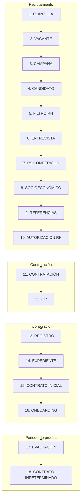

<!-- Archivo GENERADO por `npm run guia:docs` desde resources/js/lib/guia. No lo edites a mano: cambia el contenido allá y vuelve a generar. -->

# MR. LANA PEOPLE — Flujo completo

Conoce el proceso completo desde la necesidad de personal hasta la vida laboral del colaborador. Este documento es el **flujo real del sistema** (revisado contra el código) y es la misma información que se ve en **Ayuda → Guía del sistema** (`/ayuda`).

## De una vacante a un colaborador activo

| # | Paso | Quién | Dónde | Qué pasa | Guía |
|---|---|---|---|---|---|
| 1 | **Plantilla** | RH | Web | Gerencia de RH mantiene cuántas plazas autorizó Dirección por sucursal y puesto. | [Estructura, plantilla autorizada y duración por puesto](#articulo-estructura-y-plantilla) |
| 2 | **Vacante** | RH | Automático | PEOPLE calcula plantilla autorizada − ocupados. Nadie la captura a mano. | [De dónde nace una vacante](#articulo-plantilla-y-vacantes) |
| 3 | **Campaña** | RH | Web | Publicación sobre una vacante real, con gasto, sueldo publicado y evidencias. | [Crear una campaña de reclutamiento](#articulo-campanas) |
| 4 | **Candidato** | RH | Web | Se registra sobre la vacante (o como espontáneo) y entra al tablero. | [Registrar un candidato](#articulo-registrar-candidato) |
| 5 | **Filtro RH** | RH | Web y app | Primer contacto (WhatsApp, fuera de PEOPLE) y resultado: continúa o no. | [Filtro RH (primer contacto)](#articulo-filtro-rh) |
| 6 | **Entrevista** | Gerente | Web y app | El gerente de la sucursal entrevista y registra el resultado. | [Entrevista con el gerente](#articulo-entrevista-gerente) |
| 7 | **Psicométricos** | RH, Gerente | Web y app | RH registra resultados (PDF o imagen); el gerente los revisa. | [Psicométricos](#articulo-psicometricos) |
| 8 | **Socioeconómico** | Gerente | Web y app | Visita domiciliaria con checklist, riesgos y evidencias (foto, PDF, video). | [Estudio socioeconómico](#articulo-socioeconomico) |
| 9 | **Referencias** | RH, Gerente | Web y app | Al menos una referencia laboral validada. | [Validación de referencias](#articulo-referencias) |
| 10 | **Autorización RH** | Gerente, RH | Web y app | Solo RH autoriza la contratación (no hay preautorización del gerente). Si RH rechaza, el gerente puede pedir intervención. | [Autorización de RH](#articulo-autorizacion-rh) |
| 11 | **Contratación** | RH | Web | Valida que la plaza siga libre, crea a la persona sin duplicarla y ocupa la plaza. | [Iniciar la contratación (QR de contratación)](#articulo-iniciar-contratacion) |
| 12 | **QR** | RH, Colaborador | Web y app | Código temporal (máx. 24 h) y de un solo uso para registrarse. | [El QR de incorporación](#articulo-qr-incorporacion) |
| 13 | **Registro** | Colaborador | App | La persona crea su cuenta en la app, sube documentos y propone sus datos. | [Registro del colaborador en la app](#articulo-registro-en-app) |
| 14 | **Expediente** | RH | Web y app | RH aprueba los 11 documentos del alta y los datos; el expediente queda completo. | [Documentos del alta y revisión de RH](#articulo-documentos-de-alta) |
| 15 | **Contrato inicial** | RH, Gerente | Web | Paquete de contratación con la duración del puesto; se imprime, firma y archiva. | [Contrato de capacitación inicial](#articulo-contrato-inicial) |
| 16 | **Onboarding** | Colaborador, RH, Gerente | Web y app | Lecciones de bienvenida (mínimo 8) y entrega de equipo. Al cerrarlo, la persona queda ACTIVA. | [Onboarding: la bienvenida del colaborador](#articulo-onboarding) |
| 17 | **Evaluación** | Gerente, RH | Web y app | 15 días antes del fin, el jefe evalúa y RH autoriza. | [Evaluaciones de periodo de prueba](#articulo-evaluacion-capacitacion) |
| 18 | **Contrato indeterminado** | RH, Gerente | Automático | Con la evaluación aprobada, PEOPLE prepara el contrato por tiempo indeterminado. | [Contrato por tiempo indeterminado](#articulo-contrato-indeterminado) |

> El esquema original (Plantilla → … → Contrato indeterminado) tiene en el sistema real dos pasos más: **Referencias** y **Preautorización del gerente**, antes de la autorización final de RH. Y el **alta real** (colaborador activo, aviso a RH y Sistemas) ocurre al **cerrar el onboarding**, no al registrarse con el QR.

## Índice por proceso

1. **[Reclutamiento](#proceso-reclutamiento)** — De la plaza autorizada que falta a un candidato autorizado por RH: vacante real, campaña, filtro RH, entrevista, psicométricos, socioeconómico, referencias y autorización. _(1 a 3 semanas por candidato; RH, Gerente, Regional, Dirección Comercial)_
2. **[Contratación](#proceso-contratacion)** — RH genera el QR de contratación: PEOPLE valida que la plaza siga libre, crea a la persona sin duplicarla y le entrega un QR temporal de un solo uso. _(5 minutos (RH) · el QR vive 24 h; RH)_
3. **[Alta del colaborador](#proceso-alta)** — La persona escanea el QR, crea su cuenta en la app, sube sus documentos y propone sus datos; RH revisa y aprueba. El alta queda activa al cerrar el onboarding. _(1 a 5 días; Colaborador, RH, Sistemas)_
4. **[Expediente](#proceso-expediente)** — La carpeta digital de cada persona: datos, documentos, contratos, solicitudes, avisos e historial. Muestra qué falta por sección y permite avisarle al colaborador. _(Consulta inmediata; RH, Gerente, Colaborador)_
5. **[Contratos](#proceso-contratos)** — PEOPLE llena el contrato de capacitación inicial con los datos del expediente, con la duración que define cada puesto, y controla su firma y el original físico. _(1 a 3 días (firma y envío del original); RH, Gerente)_
6. **[Onboarding](#proceso-onboarding)** — Bienvenida del colaborador nuevo: lecciones institucionales y del puesto, con evaluación, y entrega del equipo de trabajo con su carta responsiva. _(1 a 2 semanas; Colaborador, RH, Gerente)_
7. **[Evaluación inicial](#proceso-evaluacion)** — 15 días antes de que termine la capacitación inicial, el jefe evalúa; RH autoriza y PEOPLE prepara el contrato por tiempo indeterminado (o la no renovación). _(15 días antes del vencimiento; Gerente, RH)_
8. **[Solicitudes](#proceso-solicitudes)** — Permisos, vacaciones y préstamos: el colaborador pide desde la app o el portal, el gerente y el regional dan visto bueno y RH autoriza. _(1 a 3 días hábiles; Colaborador, Gerente, Regional, RH)_
9. **[Nómina](#proceso-nomina)** — Recibos simples (no CFDI) por lote: semanal para sucursales y quincenal para corporativo. PEOPLE prepara, RH revisa uno por uno, emite, imprime y entrega el recibo impreso. _(30 a 60 minutos por lote; RH)_
10. **[Avisos](#proceso-avisos)** — Comunicados de RH con título, mensaje e imagen, para toda la empresa o para una persona. Llegan por notificación y push y quedan en su expediente. _(2 minutos; RH, Colaborador)_
11. **[Vida laboral](#proceso-vida-laboral)** — Lo que pasa mientras la persona trabaja: cumpleaños y aniversarios, cambios de puesto o sucursal registrados en su historial y el uso diario de la app. _(Continuo; Colaborador, RH, Gerente)_
12. **[Capacitación y Certificación](#proceso-capacitacion)** — Etapa 6 del menú: cursos en aulas tipo Classroom, asignaciones a personas, puestos o sucursales, calificación de cuestionarios y actividades, sesiones en vivo, reporte de cumplimiento y la Certificación Mr. Lana con su formato oficial firmado. _(Según el curso (días a semanas); RH, Gerente, Colaborador)_
13. **[Seguimiento y Nine Box](#proceso-seguimiento)** — Seguimientos técnicos por puesto («Seguimiento 15», «Seguimiento 30», «Seguimiento 60»…) programados solos, su calendario, los vínculos con Reportes (por persona y por sucursal) y la Nine Box: desempeño × potencial. _(Continuo (mensual o trimestral); RH, Gerente, Regional, Dirección Comercial, Colaborador)_
14. **[Baja y finiquito](#proceso-baja)** — Cierre laboral: el gerente (o RH) registra la baja en «Bajas», sin solicitud previa, y queda aplicada; se generan sus documentos y el finiquito propuesto; RH ajusta y entrega el finiquito y cierra la baja con los documentos completos. _(1 a 3 semanas; Gerente, Regional, RH, Sistemas)_
15. **[Reingresos](#proceso-reingresos)** — Volver a contratar a alguien sin crear otra persona: misma cuenta y mismo historial, un ciclo laboral nuevo. _(1 a 5 días; Gerente, RH)_
16. **[Administración](#proceso-administracion)** — Estructura (empresas, sucursales, puestos, plantilla autorizada), cuentas y roles, notificaciones, documentos maestros, la app y la bandeja Mis pendientes. _(Según el ajuste; RH, Sistemas)_

## 1. Reclutamiento

De la plaza autorizada que falta a un candidato autorizado por RH: vacante real, campaña, filtro RH, entrevista, psicométricos, socioeconómico, referencias y autorización.

**Tiempo estimado:** 1 a 3 semanas por candidato · **Roles:** RH, Gerente, Regional, Dirección Comercial · **En pantalla:** `/ayuda/proceso/reclutamiento`

### De dónde nace una vacante

> Una vacante no se captura: PEOPLE la calcula restando a la plantilla autorizada las personas que hoy ocupan el puesto.

#### Qué es

Una vacante es una plaza autorizada que hoy no tiene titular. Nadie escribe «vacante abierta»: PEOPLE compara, para cada sucursal y puesto, la plantilla autorizada contra los colaboradores vigentes que ocupan ese puesto, y lo que falta es la vacante real.

#### Quién lo hace

Gerencia de RH captura la plantilla autorizada (Organización → Sucursales). Todos los demás solo consultan Vacantes: la pantalla es informativa.

> **Importante:** Una sola fuente para todos: Vacantes, Campañas, Candidatos y la contratación consultan el mismo cálculo (plantilla autorizada − ocupados). No existen listas de vacantes paralelas.

#### Antes de empezar

- La sucursal y el puesto deben existir en Administración.
- La plantilla autorizada de ese puesto en esa sucursal debe estar capturada (viene del Excel de headcount de Dirección y Gerencia de RH la mantiene).

#### Pasos

1. **Plantilla autorizada** — Es cuántas plazas de un puesto autorizó Dirección en una sucursal. Ejemplo: Sucursal Tlaxcala, Gestor, plantilla autorizada 5.
2. **Ocupados** — PEOPLE cuenta en vivo a los colaboradores vigentes (activos o en incorporación) titulares de ese puesto en esa sucursal. El Gestor Volante cuenta como Gestor. Ejemplo: 4 gestores.
3. **Faltantes = vacantes reales** — Plantilla autorizada − ocupados, nunca menos de cero. Ejemplo: 5 − 4 = 1 vacante real de Gestor en Tlaxcala.
4. **Qué ve RH en Vacantes** _(Web)_ — Arriba, cuántas plazas faltan de cada puesto y en qué sucursales (un clic filtra). Debajo, una fila por vacante: puesto, sucursal, plazas que faltan, días abierta, candidatos que lleva y el contexto «4 de 5 ocupadas».

#### Qué pasa después

- Si alguien se da de baja, cambia de puesto o de sucursal, la vacante del lugar que deja se abre sola.
- Cuando alguien entra a esa plaza (contratación), la vacante baja o se cierra sola.
- Campañas, Candidatos y Contratación usan esta misma cifra: nadie puede publicar, registrar o contratar sobre una plaza que ya no falta.

#### Qué queda registrado

- Cada cambio de plantilla autorizada queda en el historial de la sucursal: quién, cuándo, antes → después y motivo.

#### Errores comunes

- **«No veo una vacante que debería existir.»** Revisa la plantilla autorizada de ese puesto en Organización → Sucursales → detalle. Si la plantilla ya está completa, no hay vacante. Si la sucursal no es de tu alcance, tampoco la verás.
- **«Quiero crear una vacante a mano.»** No se puede y no hace falta: Vacantes es 100 % derivada. Si Dirección autorizó una plaza nueva, Gerencia de RH la agrega a la plantilla y la vacante aparece.
- **«Alguien cubre temporalmente la plaza y la vacante sigue abierta.»** Es correcto: una cobertura temporal no cuenta como ocupado. La plaza sigue sin titular.

#### Relacionado con

- [Crear una campaña de reclutamiento](#articulo-campanas)
- [Registrar un candidato](#articulo-registrar-candidato)
- [Estructura, plantilla autorizada y duración por puesto](#articulo-estructura-y-plantilla)

#### En el sistema

- **Ir a Vacantes** → `/rh/vacantes` _(permiso: vacantes.ver)_
- **Ir a Sucursales** → `/administracion/sucursales` _(permiso: sucursales.administrar)_
- Guía en pantalla → `/ayuda/articulo/plantilla-y-vacantes`

### Crear una campaña de reclutamiento

> Una campaña siempre parte de una vacante real: registra qué se publicó, cuánto costó y qué produjo.

#### Qué es

La campaña es el registro de una publicación (Meta Ads, Indeed, Computrabajo, LinkedIn, referidos u otros) para cubrir una vacante. Sirve para saber cuánto cuesta conseguir un candidato y una contratación.

#### Quién lo hace

Reclutamiento / RH (permiso para administrar campañas). Gerencias no capturan campañas.

#### Antes de empezar

- Debe existir una vacante real con plaza disponible. Si la lista de vacantes del formulario está vacía, no hay plazas faltantes.
- Ten a la mano el texto del anuncio, la liga y el reporte o factura del proveedor.

#### Pasos

1. **Abre Campañas** _(Web)_ — Reclutamiento → Campañas → «Nueva campaña».
2. **Elige la vacante real** — Por ejemplo «Gestor — Tlaxcala». PEOPLE toma de ella la empresa, la sucursal, el departamento y el puesto: no se vuelven a capturar.
3. **Captura la campaña** — Canal, responsable, inicio y fin (opcional), presupuesto, gasto real, sueldo publicado, nombre (opcional), texto del anuncio (copy), liga del anuncio, impresiones y clics (opcionales, del reporte del proveedor), candidatos generados (opcional) y observaciones.
4. **Adjunta la evidencia** — Arte y documentos en PDF o imagen: PDF de Meta Ads, factura, captura o reporte del proveedor. Los archivos son privados y se abren desde la propia campaña.
5. **Guarda** — La campaña aparece como tarjeta con su embudo y sus costos.

#### Lo que se captura

- **Vacante y canal:** Vacante real · Canal · Responsable
- **Fechas y dinero:** Inicio · Fin (opcional) · Presupuesto · Gasto real · Sueldo publicado
- **Publicación:** Nombre de la campaña (opcional) · Texto del anuncio (copy) · Liga del anuncio · Impresiones (opcional) · Clics (opcional)
- **Evidencia y resultado:** Arte y documentos (PDF o imagen, privados) · Candidatos generados (opcional) · Observaciones

#### Qué pasa después

- Cada candidato que registres ligado a esta campaña alimenta su embudo: candidatos → contactados (llegaron a entrevista) → entrevistas → psicométricos → socioeconómicos → contratados.
- La tarjeta calcula costo por candidato (gasto ÷ candidatos), costo por colaborador contratado (gasto ÷ contratados), conversión (contratados ÷ candidatos) y días para cubrir.
- Ejemplo: $4,500 gastados, 30 candidatos y 2 contratados → $150 por candidato y $2,250 por contratación.

#### Qué queda registrado

- La campaña y sus adjuntos quedan en la bitácora con quién la creó y modificó.

#### Errores comunes

- **«El sueldo publicado es distinto al del puesto.»** Está bien: el sueldo publicado vive solo en la campaña y no modifica el catálogo de Puestos ni el sueldo con que se contrata.
- **«El embudo de la campaña sale en ceros.»** Al registrar a cada candidato, elige esa campaña en el campo «Campaña». Si no hay ninguno ligado, PEOPLE atribuye a la campaña los contratados de su misma vacante.
- **«La vacante no aparece al crear la campaña.»** Esa plaza ya se cubrió o la plantilla está completa. Revisa Vacantes.

#### Relacionado con

- [De dónde nace una vacante](#articulo-plantilla-y-vacantes)
- [Registrar un candidato](#articulo-registrar-candidato)

#### En el sistema

- **Ir a Campañas** → `/rh/campanas` _(permiso: reclutamiento.campanas.ver)_
- Guía en pantalla → `/ayuda/articulo/campanas`

### Registrar un candidato

> El candidato se registra sobre una vacante real; de ella salen la empresa, la sucursal, el departamento y el puesto.

#### Qué es

Es dar de alta a una persona interesada en una plaza. Desde ese momento entra al tablero de Candidatos en la fase «Filtro RH».

#### Quién lo hace

Reclutamiento / RH (permiso para crear candidatos).

> **Atención:** Candidato espontáneo: marca «Candidato espontáneo / sin vacante actual» solo si todavía no hay vacante para esa persona. Puede avanzar en el proceso, pero NO se puede contratar hasta vincularlo a una vacante real disponible (desde «Editar datos»).

#### Antes de empezar

- Ten el nombre y al menos un dato de contacto (teléfono o correo).
- Identifica la vacante real a la que aplica y, si llegó por una campaña, cuál.

#### Pasos

1. **Abre Candidatos** _(Web)_ — Reclutamiento → Candidatos → «Nuevo candidato».
2. **Datos de contacto** — Nombre, apellidos, teléfono y correo.
3. **Elige la vacante** — Por ejemplo «Gestor — Tlaxcala». PEOPLE muestra el puesto y la sucursal que toma de ella: no se capturan de nuevo.
4. **Campaña y fuente** — Elige la campaña de esa vacante por la que llegó (si aplica) y la fuente o canal: pauta Meta, grupos de Facebook, WhatsApp, Indeed, Computrabajo, LinkedIn, referido, orgánico u otro.
5. **Observaciones y guardar** — Agrega lo que el equipo deba saber y guarda.
6. **Sube el CV** — En la ficha del candidato, «Subir CV» (PDF o Word). Se descarga desde la ficha sin exponer dónde se guarda.

#### Lo que se captura

- **Contacto:** Nombre · Apellidos · Teléfono · Correo
- **Plaza:** Vacante (obligatoria si no es espontáneo) · Campaña de esa vacante (opcional) · Fuente / canal
- **Candidato espontáneo:** Puesto de interés · Sucursal preferida
- **Otros:** Observaciones · CV (desde la ficha)

#### Qué pasa después

- El candidato queda en «Filtro RH» y se abre el pendiente de revisión para Reclutamiento.
- Su ficha registra «Candidato registrado (fuente…)» como primer evento del historial.

#### Qué queda registrado

- Ficha del candidato con su historial (cada paso con fecha, responsable y nota) y la bitácora de auditoría.

#### Errores comunes

- **«Esta vacante ya fue cubierta. Elige otra vacante disponible.»** Alguien ocupó la última plaza mientras capturabas. Elige otra vacante o registra al candidato como espontáneo.
- **«La campaña no aparece en la lista.»** Solo se ofrecen las campañas de la vacante elegida. Elige primero la vacante.

#### Relacionado con

- [Las fases del candidato](#articulo-etapas-del-candidato)
- [Filtro RH (primer contacto)](#articulo-filtro-rh)
- [Crear una campaña de reclutamiento](#articulo-campanas)

#### En el sistema

- **Ir a Candidatos** → `/rh/candidatos` _(permiso: candidatos.ver)_
- Guía en pantalla → `/ayuda/articulo/registrar-candidato`

### Las fases del candidato

> El tablero tiene 6 fases y 2 columnas de cierre. Cada avance se hace con su acción en la ficha, nunca arrastrando.

#### Qué es

Es el recorrido de cada candidato, visible como columnas en Reclutamiento → Candidatos. Las fases agrupan los pasos internos para que RH vea solo lo importante.

#### Quién lo hace

RH, Gerente, Dirección Comercial.

> **Importante:** Arrastrar una tarjeta solo sirve para cerrar el proceso (a Rechazado o Desistió, con motivo). Para avanzar se usa la acción de la ficha («Revisar perfil», «Registrar entrevista»…): así cada paso deja su registro completo.

> **Nota:** La ficha muestra siempre quién tiene la siguiente acción (Reclutamiento, Gerente de sucursal o RH) y solo ofrece los botones que a ti te tocan.

#### Antes de empezar

- El candidato ya está registrado.

#### Pasos

1. **1 · Filtro RH** _(RH)_ — Reclutamiento revisa si el perfil cubre la vacante (primer contacto).
2. **2 · Entrevista** _(Gerente)_ — El gerente de la sucursal entrevista y registra el resultado.
3. **3 · Psicométricos** — Reclutamiento envía el link y registra resultados; el gerente los revisa.
4. **4 · Socioeconómico** _(Gerente)_ — El gerente visita el domicilio y registra el estudio con evidencias.
5. **5 · Contratación** — Agrupa: validación de referencias → autorización de RH → QR de contratación → registro y contratos.
6. **6 · Contratado** — Contratos firmados: la persona ya es colaborador e inicia onboarding.
7. **Cerrados: Rechazado · Desistió** — «No viable», «No seleccionado», «No respondió» y «Rechazado por RH» son MOTIVOS dentro de «Rechazado», no fases propias. El motivo sale del catálogo y queda en la ficha.

#### Qué pasa después

- Cada avance abre el pendiente del siguiente responsable en «Mis pendientes» (web) y en la app.
- Un candidato puede cerrarse desde reclutamiento mientras no haya entrado a contratación.

#### Qué queda registrado

- Historial del candidato: cada cambio de fase con estado anterior → nuevo, quién y nota.
- Fase máxima alcanzada (alimenta el embudo del tablero de Inicio).

#### Errores comunes

- **«No puedo arrastrar la tarjeta a la siguiente columna.»** Es a propósito. Abre la ficha y usa la acción del paso.
- **«El candidato ya está en otra fase. Recarga la ficha.»** Otra persona avanzó el paso al mismo tiempo. Recarga y revisa el historial.

#### Relacionado con

- [Filtro RH (primer contacto)](#articulo-filtro-rh)
- [Entrevista con el gerente](#articulo-entrevista-gerente)
- [Autorización de RH](#articulo-autorizacion-rh)

#### En el sistema

- **Ir a Candidatos** → `/rh/candidatos` _(permiso: candidatos.ver)_
- Guía en pantalla → `/ayuda/articulo/etapas-del-candidato`

### Filtro RH (primer contacto)

> Reclutamiento contacta al candidato (normalmente por WhatsApp) y registra si continúa o no.

#### Qué es

Es la primera revisión del perfil. El contacto se hace fuera del sistema (WhatsApp, llamada); PEOPLE NO envía ese mensaje, solo registra el resultado.

#### Quién lo hace

RH.

#### Antes de empezar

- El candidato está en «Filtro RH».

#### Pasos

1. **Contacta al candidato** — Por WhatsApp o llamada, fuera de PEOPLE.
2. **Abre su ficha** _(Web y app)_ — Candidatos → tarjeta del candidato.
3. **«Revisar perfil»** — Elige el resultado: continúa (viable) o no continúa. Escribe observaciones. La fecha y el responsable se guardan solos.
4. **Si no continúa** — El motivo es obligatorio (catálogo de motivos de rechazo) y decides si la persona puede considerarse de nuevo en el futuro.

#### Qué pasa después

- Continúa → pasa a «Entrevista» y le llega el pendiente al gerente de la sucursal.
- No continúa → queda en «Rechazado» con su motivo.

#### Qué queda registrado

- Fecha, responsable, notas y resultado en el historial del candidato.

#### Errores comunes

- **«No me deja guardar el rechazo.»** Elige un motivo del catálogo: es obligatorio.

#### Relacionado con

- [Entrevista con el gerente](#articulo-entrevista-gerente)
- [Las fases del candidato](#articulo-etapas-del-candidato)

#### En el sistema

- **Ir a Candidatos** → `/rh/candidatos` _(permiso: candidatos.ver)_
- Guía en pantalla → `/ayuda/articulo/filtro-rh`

### Entrevista con el gerente

> El responsable de la vacante entrevista y registra fecha, observaciones y resultado: el gerente de la sucursal; si la vacante es de Gerente de sucursal, el Gerente Regional.

#### Qué es

Es la entrevista del responsable de la vacante (sale del organigrama: vacante → sucursal → puesto). Una vacante de gerente nunca se entrevista a sí misma: la entrevista el Regional. Entrevistar no es autorizar: la contratación la autoriza RH.

#### Quién lo hace

Gerente, Regional.

#### Antes de empezar

- El candidato pasó el Filtro RH y aparece en tus pendientes.

#### Pasos

1. **Abre el pendiente** _(Web y app)_ — Mis pendientes o Candidatos → ficha del candidato.
2. **«Registrar entrevista»** — Fecha y hora, observaciones y resultado (viable / no viable).
3. **Si no es viable** — Motivo obligatorio del catálogo.

#### Qué pasa después

- Viable → pasa a «Psicométricos» y Reclutamiento recibe el pendiente de enviar el link.
- No viable → «Rechazado» con motivo.

#### Qué queda registrado

- Entrevista (fecha, entrevistador, observaciones, resultado) en «Evaluaciones registradas» de la ficha.

#### Errores comunes

- **«No me aparece el botón Registrar entrevista.»** Solo lo ve quien tiene permiso de evaluar candidatos y alcance sobre esa sucursal. Revisa que la vacante sea de tu sucursal.

#### Relacionado con

- [Psicométricos](#articulo-psicometricos)
- [Filtro RH (primer contacto)](#articulo-filtro-rh)

#### En el sistema

- **Ir a Mis pendientes** → `/rh/pendientes`
- Guía en pantalla → `/ayuda/articulo/entrevista-gerente`

### Psicométricos

> Reclutamiento envía el link y carga el resultado (PDF o imagen). Cargar NO decide: queda pendiente de revisión hasta que el responsable lo abre y dice viable o no viable.

#### Qué es

Son las pruebas psicométricas del candidato. Se aplican en la plataforma del proveedor; PEOPLE guarda el link, el resumen y los reportes, y registra la revisión del gerente.

#### Quién lo hace

Reclutamiento envía y carga; el responsable de la vacante (gerente de la sucursal; para una vacante de gerente, el Regional) revisa.

#### Antes de empezar

- El candidato pasó la entrevista.

#### Pasos

1. **«Registrar link de psicométricas»** _(RH)_ — Pega la liga que se le envió al candidato (opcional, para dejar constancia).
2. **«Cargar resultados psicométricos»** _(RH)_ — Resumen y hasta 5 reportes en PDF o imagen (JPG, PNG, WEBP). El candidato queda «Revisión de psicométricas»: todavía no avanza.
3. **«Ver psicométrico» y «Revisar psicométrico»** _(Gerente)_ — El responsable abre el PDF (botón arriba de la ficha) y decide Viable o No viable, con observaciones. Solo entonces avanza.
4. **Ver la evidencia sin salir de PEOPLE** — En la ficha, «Evaluaciones registradas» → clic en el archivo: el PDF y las imágenes se abren en un visor dentro de PEOPLE.

#### Qué pasa después

- Viable → «Socioeconómico».
- No viable → «Rechazado» con motivo.

#### Qué queda registrado

- Link, fecha de envío, resumen, reportes, revisión y responsable.

#### Errores comunes

- **«¿Dónde quedó guardado el reporte?»** En el almacenamiento privado de PEOPLE. Nunca se muestra la ruta del servidor: se abre siempre desde la ficha.

#### Relacionado con

- [Estudio socioeconómico](#articulo-socioeconomico)
- [Entrevista con el gerente](#articulo-entrevista-gerente)

#### En el sistema

- **Ir a Candidatos** → `/rh/candidatos` _(permiso: candidatos.ver)_
- Guía en pantalla → `/ayuda/articulo/psicometricos`

### Estudio socioeconómico

> Se carga el estudio (video, PDF o fotos de la visita). Cargar NO es aprobar: el responsable lo abre y decide viable o no viable.

#### Qué es

Es la visita domiciliaria al candidato. PEOPLE guarda los datos de la visita, un checklist, los riesgos y las evidencias, separadas de las del psicométrico.

#### Quién lo hace

Gerente, RH.

#### Antes de empezar

- Las psicométricas quedaron en perfil.

#### Pasos

1. **«Cargar estudio socioeconómico»** — Fecha de visita, dirección visitada y checklist: vivienda en orden, vive con su familia, tiempo en la vivienda (años y meses) y resguardo de motocicleta. Queda «pendiente de revisión».
2. **Riesgos y observaciones** — Riesgos o inconsistencias detectados y observaciones.
3. **Evidencias** — Hasta 12 archivos: fotos (JPG, PNG, WEBP), PDF o video (MP4, MOV).
4. **«Revisar socioeconómico»** _(Gerente)_ — El responsable abre el video o el PDF («Ver socioeconómico» / «Ver video») y decide Viable o No viable (si no es viable, motivo obligatorio).
5. **Abrir las evidencias** — En la ficha, clic en cada archivo: imagen y PDF se ven en línea; el video se reproduce dentro de PEOPLE.

#### Qué pasa después

- Revisado viable → «Validación de referencias».
- Revisado no viable → «Rechazado».

#### Qué queda registrado

- Estudio completo con visitador, checklist, riesgos y evidencias en la ficha.

#### Errores comunes

- **«El video no sube.»** Usa MP4 o MOV y revisa el tamaño máximo permitido.

#### Relacionado con

- [Validación de referencias](#articulo-referencias)
- [Psicométricos](#articulo-psicometricos)

#### En el sistema

- **Ir a Candidatos** → `/rh/candidatos` _(permiso: candidatos.ver)_
- Guía en pantalla → `/ayuda/articulo/socioeconomico`

### Validación de referencias

> Se registra al menos una referencia laboral validada; al concluir, el candidato pasa directo a la autorización de RH.

#### Qué es

Es la verificación de referencias laborales del candidato (empresa, contacto, resultado).

#### Quién lo hace

RH, Gerente.

#### Antes de empezar

- El socioeconómico quedó viable.

#### Pasos

1. **«Registrar referencia»** — Empresa, contacto, teléfono, relación o puesto, resultado y observaciones. Repite por cada referencia.
2. **«Concluir validación de referencias»** — Indica si las referencias son favorables. Se exige al menos una registrada.

#### Qué pasa después

- Favorables → «Autorización de RH».
- No favorables → «Rechazado» con motivo.

#### Qué queda registrado

- Cada referencia con quién la validó y cuándo.

#### Errores comunes

- **«Registra al menos una referencia laboral validada antes de continuar.»** La ficha lo avisa antes de concluir. Captura una referencia con «Registrar referencia» (botón en el mismo aviso) y vuelve a concluir.

#### Relacionado con

- [Autorización de RH](#articulo-autorizacion-rh)

#### En el sistema

- **Ir a Candidatos** → `/rh/candidatos` _(permiso: candidatos.ver)_
- Guía en pantalla → `/ayuda/articulo/referencias`

### Autorización de RH

> Solo RH autoriza la contratación, después de que el responsable revisó entrevista, psicométricos y socioeconómico y se validaron referencias. El gerente no autoriza contrataciones.

#### Qué es

Es la decisión de contratar. Siempre es de Recursos Humanos; no hay preautorización del gerente.

#### Quién lo hace

RH.

> **Importante:** Caso normal: RH aprueba → el candidato continúa. NO se manda al Regional ni a Dirección Comercial. Ellos solo intervienen si, después de un rechazo de RH, el gerente pide una intervención.

#### Antes de empezar

- Las referencias se concluyeron favorables.

#### Pasos

1. **«Autorizar contratación»** _(RH)_ — RH da la autorización final. El candidato queda «Autorizado por RH» y aparece el botón para generar el QR.
2. **O bien «Devolver a referencias»** _(RH)_ — Con motivo, si falta algo: regresa a la validación de referencias.
3. **O bien «Rechazar»** _(RH)_ — Con motivo del catálogo: el candidato queda «Rechazado por RH».

#### Qué pasa después

- Autorizado → RH ve «Generar QR de contratación».
- Rechazado por RH → el gerente que entrevistó puede aceptar el rechazo o «Solicitar intervención».

#### Notificaciones

- «Autorización de RH» como pendiente a quien autoriza (prioridad alta).

#### Qué queda registrado

- Aprobación con el nombre de quien autorizó (queda fijo aunque después cambie el jefe).

#### Errores comunes

- **«No veo el botón Autorizar contratación.»** La autorización requiere el permiso de RH y alcance sobre ese candidato. El gerente nunca autoriza contrataciones.

#### Relacionado con

- [Intervención sobre un rechazo de RH](#articulo-intervencion)
- [Iniciar la contratación (QR de contratación)](#articulo-iniciar-contratacion)

#### En el sistema

- **Ir a Mis pendientes** → `/rh/pendientes`
- Guía en pantalla → `/ayuda/articulo/autorizacion-rh`

### Intervención sobre un rechazo de RH

> Solo si el gerente la pide: Regional (gestor o volante) o Dirección Comercial (puestos superiores) deciden.

#### Qué es

Es una excepción. Cuando RH rechaza a un candidato, el gerente que lo entrevistó puede aceptar el rechazo o pedir que se reconsidere. Nunca es automático.

#### Quién lo hace

Solicita: el gerente que entrevistó. Decide: el Gerente Regional de la sucursal si el puesto es Gestor o Gestor Volante; Dirección Comercial para cualquier puesto superior.

#### Antes de empezar

- El candidato está «Rechazado por RH» y no hay otra intervención pendiente.

#### Pasos

1. **«Solicitar intervención»** _(Gerente)_ — En la ficha, el gerente explica por qué debería reconsiderarse (motivo obligatorio).
2. **Decisión** _(Regional)_ — Quien corresponde ve «Aprobar intervención» o «Confirmar rechazo», con comentario.

#### Qué pasa después

- Aprobada → el candidato pasa a «Autorizado por RH» y puede contratarse (nunca se le inventa una vacante).
- Rechazo confirmado → queda rechazado.
- La decisión es definitiva y queda en la ficha.

#### Qué queda registrado

- Rechazo de RH, solicitud, decisión, aprobador y comentarios en la sección «Intervención sobre el rechazo de RH».

#### Errores comunes

- **«No veo Solicitar intervención.»** Solo aparece al gerente con permiso de evaluar y si no hay ya una intervención pendiente.

#### Relacionado con

- [Autorización de RH](#articulo-autorizacion-rh)

#### En el sistema

- **Ir a Candidatos** → `/rh/candidatos` _(permiso: candidatos.ver)_
- Guía en pantalla → `/ayuda/articulo/intervencion`

## 2. Contratación

RH genera el QR de contratación: PEOPLE valida que la plaza siga libre, crea a la persona sin duplicarla y le entrega un QR temporal de un solo uso.

**Tiempo estimado:** 5 minutos (RH) · el QR vive 24 h · **Roles:** RH · **En pantalla:** `/ayuda/proceso/contratacion`

### Iniciar la contratación (QR de contratación)

> Con el candidato autorizado por RH, «Generar QR de contratación» crea a la persona en contratación, ocupa la plaza y entrega un QR de un solo uso.

#### Qué es

Es el paso que convierte al candidato autorizado en una persona en contratación. Todo ocurre en un solo movimiento y sin duplicar a nadie.

#### Quién lo hace

RH con permiso para contratar candidatos, dentro de su alcance.

> **Importante:** La sucursal, el departamento y el puesto salen SIEMPRE de la vacante. Aunque alguien manipule el formulario, PEOPLE no contrata en otra plaza.

#### Antes de empezar

- El candidato está «Autorizado por RH».
- Está vinculado a una vacante real (un espontáneo primero se vincula desde «Editar datos»).
- El puesto tiene configurada su duración de capacitación inicial (Configuración → Parámetros de RH).

#### Pasos

1. **Abre la ficha del candidato** _(Web)_ — Candidatos → candidato autorizado.
2. **«Generar QR de contratación»** — Captura sueldo mensual, fecha de ingreso, modalidad (capacitación inicial) y, si quieres, el fin del periodo. Vacío = según la duración del puesto.
3. **Confirma** — PEOPLE bloquea la vacante y revisa que la plaza siga libre ANTES de crear a la persona. Si dos personas intentan ocupar la última plaza al mismo tiempo, la segunda recibe «La vacante ya fue cubierta».

#### Qué pasa después

- Se crea el colaborador con estatus «en incorporación», su número de empleado y su expediente, ligado al candidato (no son dos personas).
- Se crea su contrato de capacitación inicial con fecha de fin calculada por el puesto.
- La vacante cuenta la plaza como ocupada (si era la última, se cierra).
- El CV del candidato se copia a su expediente.
- Se genera el QR de registro: temporal (24 h por defecto, nunca más de 24 h), de un solo uso y revocable.
- El candidato pasa a «En contratación».

#### Qué queda registrado

- Historial del candidato: «Inició la contratación: colaborador N creado y QR de registro generado».
- Bitácora: contratación iniciada con candidato, colaborador e invitación.

#### Errores comunes

- **«Este candidato es espontáneo: vincúlalo a una vacante disponible antes de iniciar su contratación.»** Abre «Editar datos», elige la vacante real y vuelve a intentarlo.
- **«Configura la duración de capacitación inicial para este puesto…»** Gerencia de RH entra a Administración → Configuración → Parámetros de RH y captura los meses del puesto. No existe una duración genérica.
- **«La vacante ya fue cubierta.»** Alguien ocupó la última plaza antes. Vincula al candidato a otra vacante disponible.
- **«Ya existe una cuenta con ese correo: si es un reingreso, búscalo en Reingresos.»** Es alguien que ya trabajó en MR. LANA: usa Reingresos para no duplicar a la persona.

#### Relacionado con

- [El QR de incorporación](#articulo-qr-incorporacion)
- [Registro del colaborador en la app](#articulo-registro-en-app)
- [Del candidato al colaborador (sin duplicar a nadie)](#articulo-candidato-a-colaborador)

#### En el sistema

- **Ir a Candidatos** → `/rh/candidatos` _(permiso: candidatos.ver)_
- Guía en pantalla → `/ayuda/articulo/iniciar-contratacion`

### El QR de incorporación

> No es solo un formulario: es la puerta de entrada de la persona. Al escanearlo crea su cuenta sobre el mismo colaborador que preparó RH.

#### Qué es

Es un código temporal y de un solo uso, ligado al candidato y a su colaborador. Nadie puede registrarse en la app sin una invitación activa.

#### Quién lo hace

RH, Colaborador.

#### Antes de empezar

- La contratación ya se inició desde la ficha del candidato.

#### Pasos

1. **Qué ve RH** _(RH)_ — En la ficha del candidato, el bloque «QR de contratación» con su estado y vencimiento, y «Ver / regenerar QR». En el detalle: copiar liga, descargar PNG, regenerar o revocar.
2. **Qué recibe la persona** _(Colaborador)_ — El QR impreso o la liga (por WhatsApp, por ejemplo). Al escanearlo, su celular abre la pantalla de incorporación de MR. LANA PEOPLE: si tiene la app, la abre; si no, ofrece «Descargar app».
3. **Qué ve el gerente** _(Gerente)_ — El candidato en la fase «Contratación» del tablero y, más adelante, los contratos por imprimir en sus pendientes.
4. **Si venció o no se usó** _(RH)_ — Reclutamiento → Invitaciones QR → «Nueva invitación»: elige a la persona en contratación (solo aparecen quienes no tienen un QR vigente) y su vigencia de 1 a 24 horas.

#### Qué pasa después

- Al usarse, la invitación queda «Usada» y no vuelve a funcionar.
- Un token inválido, vencido o revocado muestra un mensaje claro, nunca un error.

#### Qué queda registrado

- Cada invitación: quién la creó, vigencia, usos, quién la usó y cuándo. Nunca se guarda el código en claro.

#### Errores comunes

- **«El QR ya no funciona.»** Venció (vive como máximo 24 h) o ya se usó. Regénéralo desde la invitación o crea una nueva.
- **«No encuentro a la persona en Nueva invitación.»** Solo aparecen personas en contratación sin un QR vigente y sin cuenta. Si su QR sigue vigente, compártelo de nuevo.

#### Relacionado con

- [Iniciar la contratación (QR de contratación)](#articulo-iniciar-contratacion)
- [Registro del colaborador en la app](#articulo-registro-en-app)

#### En el sistema

- **Ir a Invitaciones QR** → `/rh/incorporacion/invitaciones` _(permiso: rh.incorporacion.invitaciones.ver)_
- Guía en pantalla → `/ayuda/articulo/qr-incorporacion`

## 3. Alta del colaborador

La persona escanea el QR, crea su cuenta en la app, sube sus documentos y propone sus datos; RH revisa y aprueba. El alta queda activa al cerrar el onboarding.

**Tiempo estimado:** 1 a 5 días · **Roles:** Colaborador, RH, Sistemas · **En pantalla:** `/ayuda/proceso/alta`

### Registro del colaborador en la app

> La persona escanea el QR, confirma sus datos básicos y crea su contraseña. Después sube documentos y completa su información.

#### Qué es

Es lo que hace la persona nueva desde su celular para crear su cuenta. El formulario es corto a propósito: lo laboral ya lo definió RH.

#### Quién lo hace

Colaborador.

> **Importante:** La persona NO captura empresa, sucursal, puesto, vacante, fecha de ingreso ni tipo de contrato: vienen del proceso de RH y de la vacante. Así no quedan a criterio del candidato.

#### Antes de empezar

- Tener el QR vigente y la app MR. LANA PEOPLE instalada (si no, la pantalla del QR ofrece descargarla).

#### Pasos

1. **Escanea el QR** _(App)_ — Con la cámara del celular o desde «Escanear QR» en la pantalla de inicio de sesión de la app.
2. **Confirma tus datos** _(App)_ — Nombre (obligatorio), apellidos, correo electrónico (opcional) y teléfono.
3. **Crea tu contraseña** _(App)_ — Mínimo 8 caracteres y confírmala. Tu usuario se genera solo: primer nombre + primer apellido (por ejemplo «Juan Perez»).
4. **Sigue la hoja de ruta** _(App)_ — La app muestra tres fases: Datos personales → Documentos → Revisión RH.

#### Lo que se captura

- **Registro con el QR:** Nombre · Apellidos · Correo electrónico (opcional) · Teléfono · Contraseña · Confirmar contraseña

#### Qué pasa después

- Se crea su cuenta (rol colaborador) sobre el MISMO colaborador que preparó RH; la invitación queda usada.
- Su acceso es de incorporación: puede entrar a la app a subir documentos y completar datos, pero todavía no es colaborador activo.

#### Qué queda registrado

- Invitación usada (quién y cuándo) y cuenta creada en la bitácora.

#### Errores comunes

- **«El correo no coincide con la invitación.»** Usa el correo que registró RH o déjalo vacío.
- **«Ese correo ya está registrado.»** Pide a RH que revise: puede tratarse de un reingreso.

#### Relacionado con

- [Documentos del alta y revisión de RH](#articulo-documentos-de-alta)
- [Completar o corregir datos (colaborador)](#articulo-completar-datos)
- [El QR de incorporación](#articulo-qr-incorporacion)

#### En el sistema

- **Descargar la app** → `/app`
- Guía en pantalla → `/ayuda/articulo/registro-en-app`

### Documentos del alta y revisión de RH

> La persona sube los 11 documentos obligatorios desde la app; RH los aprueba, rechaza o pide corrección.

#### Qué es

Es la integración del expediente de la persona nueva. Solo se piden los documentos obligatorios del alta; los demás (contratos firmados, permisos…) nacen después.

#### Quién lo hace

Colaborador, RH.

#### Antes de empezar

- La persona ya creó su cuenta con el QR.

#### Pasos

1. **Sube cada documento** _(Colaborador · App)_ — App → «Mi incorporación»: toca cada documento pendiente y súbelo (foto o PDF).
2. **Revisa en el expediente** _(RH · Web y app)_ — Expedientes → la persona → «Documentos»: abre cada archivo sin salir de PEOPLE y aprueba, rechaza (con motivo) o pide corrección.
3. **Aprovecha la lectura automática** _(RH)_ — De identificaciones como INE, CURP o constancia fiscal, PEOPLE puede proponer datos (nombre, CURP, RFC…). RH revisa y decide aplicarlos o ignorarlos.

#### Lo que se captura

- **Documentos obligatorios del alta:** Solicitud de empleo (formato interno) · 2 fotografías tamaño infantil · Acta de nacimiento · Identificación oficial · Número de Seguridad Social · CURP · Constancia de situación fiscal (RFC) · Comprobante de domicilio · Comprobante de estudios · Carta de recomendación (la segunda carta es opcional: con una aprobada el expediente queda completo; cada carta se sube como foto o PDF, o las dos en un solo archivo marcando «trae también la otra carta») · Datos bancarios (cuenta, tarjeta y CLABE)

#### Qué pasa después

- Cada documento rechazado le llega a la persona con su motivo (notificación y push) para que lo vuelva a subir.
- Las cartas de recomendación se revisan por separado: puedes aprobar las dos, o aprobar una y rechazar la otra. Solo la carta 1 es obligatoria.
- Cuando el último obligatorio queda aprobado, RH recibe «Expediente completo» y el pendiente «Generar paquete de contratación».
- Un documento ya aprobado no se reemplaza directo: la persona solicita el cambio y RH lo autoriza.

#### Notificaciones

- Documento aprobado / rechazado → colaborador (notificación + push).
- Expediente completo → RH con alcance.

#### Qué queda registrado

- Cada versión del documento con quién lo subió, quién lo revisó, cuándo y el motivo.

#### Errores comunes

- **«El avance no sube.»** Solo cuentan los documentos APROBADOS; cargado o en revisión todavía no.
- **«No puedo volver a subir un documento aprobado.»** Toca «Solicitar cambio»: cuando RH lo autorice, podrás subir la nueva versión.

#### Relacionado con

- [Completar o corregir datos (colaborador)](#articulo-completar-datos)
- [Contrato de capacitación inicial](#articulo-contrato-inicial)
- [El expediente del colaborador](#articulo-expediente)

#### En el sistema

- **Ir a Expedientes** → `/rh/expedientes` _(permiso: expedientes.ver_todos o expedientes.ver_sucursal)_
- Guía en pantalla → `/ayuda/articulo/documentos-de-alta`

### Del candidato al colaborador (sin duplicar a nadie)

> Candidato y colaborador son la misma persona: PEOPLE los liga desde la contratación y conserva todo el historial.

#### Qué es

Es la regla con la que PEOPLE convierte a un candidato en colaborador. Nunca crea dos personas independientes.

#### Quién lo hace

RH.

#### Antes de empezar

- La contratación se inició desde la ficha del candidato.

#### Pasos

1. **Al generar el QR** — Se crea el colaborador ligado al candidato: número de empleado, expediente, empresa, sucursal, puesto, contrato de capacitación inicial y ocupación de la plaza.
2. **Al registrarse con el QR** — Se crea su cuenta sobre ese mismo colaborador.
3. **Al firmar los contratos** — El candidato pasa a «Contratado» y empieza el onboarding.
4. **Al cerrar el onboarding** — El colaborador queda ACTIVO (alta real) y se avisa a RH y Sistemas.

#### Qué pasa después

- La ficha del candidato y el expediente del colaborador apuntan uno al otro: el reclutamiento queda como antecedente consultable.
- Su actividad laboral empieza con el movimiento «Alta».

#### Qué queda registrado

- Ciclo laboral de la persona: cada etapa con fecha y responsable.

#### Errores comunes

- **«La CURP/RFC/NSS ya pertenece a otra persona.»** PEOPLE impide duplicados. Si esa persona ya trabajó aquí, usa Reingresos.

#### Relacionado con

- [Alta real: colaborador activo](#articulo-alta-activa)
- [Reingreso de un excolaborador](#articulo-reingreso)

#### En el sistema

- **Ir a Expedientes** → `/rh/expedientes` _(permiso: expedientes.ver_todos o expedientes.ver_sucursal)_
- Guía en pantalla → `/ayuda/articulo/candidato-a-colaborador`

### Alta real: colaborador activo

> La persona queda activa cuando su expediente está aprobado, sus contratos firmados y su onboarding cerrado. Entonces se avisa a RH y a Sistemas.

#### Qué es

Es el momento en que la persona deja de estar «en incorporación» y empieza a operar. PEOPLE lo hace al cerrar el onboarding.

#### Quién lo hace

RH, Sistemas.

#### Antes de empezar

- Expediente con documentos obligatorios aprobados.
- Contratos de contratación firmados.
- Onboarding completado (lecciones aprobadas y equipo entregado).

#### Pasos

1. **RH cierra el onboarding** _(RH)_ — Ciclo laboral de la persona → «Cerrar onboarding». PEOPLE la activa en ese mismo paso.
2. **Sistemas prepara accesos** _(Sistemas)_ — Recibe el correo «Alta en sistemas» en cuanto la persona completa sus datos personales, y lo atiende en Contratación → «Pendientes de alta en sistemas» («Marcar como dado de alta»).

#### Qué pasa después

- El colaborador recibe «¡Bienvenido a MR. LANA! Ya tienes acceso completo a tu portal.»
- Se recalcula la vacante de su sucursal y puesto.

#### Notificaciones

- RH: documentación y seguimiento.
- Sistemas: cuentas, accesos y equipo.
- Colaborador: bienvenida.

#### Qué queda registrado

- Bitácora «colaborador activado» y actividad laboral.

#### Errores comunes

- **«No se puede activar todavía: está en …»** Falta algo del checklist: documentos, firma de contratos u onboarding. El ciclo laboral muestra qué y a quién le toca.

#### Relacionado con

- [Onboarding: la bienvenida del colaborador](#articulo-onboarding)
- [Cuentas, credenciales y roles (Sistemas)](#articulo-usuarios-y-roles)
- [Pendientes de alta y de baja en sistemas](#articulo-pendientes-sistemas)

#### En el sistema

- **Ir a Mis pendientes** → `/rh/pendientes`
- Guía en pantalla → `/ayuda/articulo/alta-activa`

## 4. Expediente

La carpeta digital de cada persona: datos, documentos, contratos, solicitudes, avisos e historial. Muestra qué falta por sección y permite avisarle al colaborador.

**Tiempo estimado:** Consulta inmediata · **Roles:** RH, Gerente, Colaborador · **En pantalla:** `/ayuda/proceso/expediente`

### El expediente del colaborador

> La carpeta digital de la persona, organizada en pestañas. Nada se borra nunca.

#### Qué es

Es todo lo que RH guarda de una persona: datos, documentos, cuenta, onboarding, avisos, vacaciones, recibos, préstamos, solicitudes e historial.

#### Quién lo hace

RH ve todos los expedientes; gerencias, los de su sucursal; el colaborador (incluidas las coordinadoras), solo el suyo (Mi expediente).

#### Antes de empezar

- Tener permiso de expedientes (RH o gerencia) o ser el propio colaborador.

#### Pasos

1. **Busca a la persona** _(Web)_ — Expedientes → busca por nombre o número de empleado.
2. **Revisa las pestañas** — Resumen · Datos personales · Datos laborales · Cuenta · Documentos · Onboarding · Avisos / Comunicaciones · Vacaciones · Recibos de nómina · Préstamos · Solicitudes · Historial RH.
3. **Documentos del proceso** — Debajo están los documentos generados por PEOPLE (contratos, permisos, préstamo, baja) con su estado de firma y del original físico.

#### Qué pasa después

- El colaborador ve su propio expediente en Mi expediente (sin la pestaña Cuenta ni Checklist).

#### Qué queda registrado

- Historial RH: cada cambio con quién, cuándo y valores anteriores.

#### Errores comunes

- **«Quiero corregir mi propio expediente y no puedo.»** Nadie edita su propio expediente, ni RH. Usa «Solicitar corrección»: otra persona de RH lo autoriza.
- **«Di de baja a alguien y no desaparece.»** Es correcto: la baja bloquea el acceso y conserva todo el historial para un posible reingreso.

#### Relacionado con

- [Qué le falta a un expediente (y cómo avisar)](#articulo-completitud-expediente)
- [Completar o corregir datos (colaborador)](#articulo-completar-datos)
- [Actividad laboral (historial de movimientos)](#articulo-actividad-laboral)

#### En el sistema

- **Ir a Expedientes** → `/rh/expedientes` _(permiso: expedientes.ver_todos o expedientes.ver_sucursal)_
- **Ir a Mi expediente** → `/mi-expediente`
- Guía en pantalla → `/ayuda/articulo/expediente`

### Qué le falta a un expediente (y cómo avisar)

> El expediente no muestra solo un porcentaje: dice qué sección está completa y cuál no, y RH puede avisarle al colaborador.

#### Qué es

Es el semáforo por secciones del expediente: Identidad, Fiscal, Laboral, Domicilio, Contacto, Contacto de emergencia, Beneficiario y Documentos.

#### Quién lo hace

RH, Colaborador.

#### Antes de empezar

- Abrir el expediente de la persona.

#### Pasos

1. **Lee el aviso de datos faltantes** _(RH)_ — Por ejemplo: Identidad ✓ · Fiscal ✓ · Laboral ✓ · Domicilio ⚠ (falta el código postal) · Contacto de emergencia ✗ · Documentos ✓.
2. **«Avisar al colaborador»** _(RH)_ — Le llega una notificación y un push con la lista de lo que falta. Se puede repetir una vez cada 24 horas.
3. **El colaborador completa** _(Colaborador · App)_ — App → Inicio → «Completa tu información» → envía los datos a RH.

#### Lo que se captura

- **Identidad:** Sexo · Fecha de nacimiento · Estado civil · CURP
- **Fiscal:** RFC · Número de seguridad social (NSS)
- **Laboral (lo captura RH):** Puesto · Sucursal · Fecha de ingreso · Sueldo · Tipo de contrato
- **Domicilio:** Domicilio · Código postal
- **Contacto:** Teléfono celular · Correo electrónico
- **Contacto de emergencia:** Nombre · Parentesco · Teléfono
- **Beneficiario:** Nombre · Parentesco

#### Qué pasa después

- Cuando RH autoriza los datos propuestos, el semáforo se recalcula solo.

#### Notificaciones

- Aviso de datos faltantes → colaborador (notificación + push).

#### Qué queda registrado

- Último aviso enviado (fecha y quién) en el propio expediente.

#### Errores comunes

- **«El botón Avisar está deshabilitado.»** Ya se avisó en las últimas 24 horas, o la persona ya envió una solicitud que está en revisión.

#### Relacionado con

- [Completar o corregir datos (colaborador)](#articulo-completar-datos)
- [Contrato de capacitación inicial](#articulo-contrato-inicial)

#### En el sistema

- **Ir a Expedientes** → `/rh/expedientes` _(permiso: expedientes.ver_todos o expedientes.ver_sucursal)_
- Guía en pantalla → `/ayuda/articulo/completitud-expediente`

### Fechas laborales: ingreso, capacitación inicial y periodo de prueba

> Una sola fuente para las fechas de cada persona (ingreso, inicio de capacitación inicial, inducción, alta IMSS) y su periodo de prueba (hereda del puesto o específico), con vista del impacto antes de guardar y captura masiva.

#### Qué es

De estas fechas salen el fin del periodo de prueba, la fecha de su evaluación y el calendario de sus Seguimientos técnicos. Se ven y corrigen en el expediente (pestaña «Fechas laborales») o, para muchas personas a la vez (por ejemplo la plantilla importada por Excel), en Permanencia → «Fechas laborales». El contrato nunca se cambia solo.

#### Quién lo hace

Quien tiene el permiso expedientes.editar_fechas (todo rol que puede editar expedientes). Nadie corrige sus propias fechas.

> **Importante:** El contrato nunca se modifica desde aquí: sus fechas se corrigen en el contrato. La fecha de ingreso no se corrige si ya hay contrato firmado, recibos emitidos o finiquito firmado o pagado; el inicio de capacitación y el periodo de prueba sí.

> **Nota:** Vacío = hereda del puesto. Si el inicio de capacitación inicial está vacío, se usa la fecha de ingreso.

#### Antes de empezar

- El puesto tiene su periodo de prueba en el catálogo de puestos (si la persona no lleva uno específico).
- Tener a la mano el motivo del cambio: queda en el historial.

#### Pasos

1. **Una persona: abre su expediente** — Colaboradores → la persona → grupo «Datos» → pestaña «Fechas laborales». Verás la línea de tiempo (Ingreso, Alta IMSS, Inducción, Inicia capacitación inicial, cada Seguimiento, Se habilita la evaluación, Fin del periodo de prueba) y las alertas.
2. **Edita las fechas** — «Editar fechas» (o «Capturar» en una fecha que falta). Captura las fechas y elige el periodo de prueba: «Hereda del puesto» o «Específico para esta persona» (duración en meses o días).
3. **Revisa el impacto** — «Ver impacto» muestra lo capturado, las fechas que se recalculan (antes → después) y qué más se afecta («Requiere nuevo contrato», «Debes revisarlo»…).
4. **Guarda con motivo** — Escribe el «Motivo del cambio» y pulsa «Guardar fechas». PEOPLE recalcula el fin del periodo de prueba, reprograma los Seguimientos pendientes y mueve la fecha límite de la evaluación de periodo de prueba pendiente.
5. **Atiende las alertas** — Si aparece «Debes actualizar el contrato», pulsa «Actualizar contrato»; si el contrato ya estaba firmado, «La fecha impresa en el contrato firmado ya no coincide: genera uno nuevo». Cada alerta desaparece sola al corregir su causa.
6. **Muchas personas: captura masiva** — Permanencia → «Fechas laborales» (o «Captura masiva» desde el expediente). Filtra por nombre, sucursal o puesto y deja «Con fechas faltantes». Edita las celdas en la tabla; aparece la barra «N persona(s) con cambios»: escribe el motivo (mínimo 5 caracteres) y pulsa «Guardar».

#### Qué pasa después

- En la captura masiva cada persona se guarda por separado: «Se guardaron N; M con error (revisa las filas marcadas)». Las filas con error quedan en rojo con su mensaje.
- Los Seguimientos ya contestados no se tocan.

#### Qué queda registrado

- Cada cambio es una corrección auditada con su motivo (Cambios de datos → Correcciones auditadas), antes y después.

#### Errores comunes

- **«La fecha de ingreso no se corrige porque …»** Ya hay contrato firmado, recibos emitidos o finiquito: mueve el inicio de la capacitación inicial o el periodo de prueba, o corrige el contrato.
- **«Captura la cantidad y la unidad (meses o días) del periodo específico…»** Llena ambas o deja ambas vacías para heredar el del puesto.

#### Relacionado con

- [El expediente del colaborador](#articulo-expediente)
- [Evaluaciones de periodo de prueba](#articulo-evaluacion-capacitacion)
- [Seguimientos técnicos: «Seguimiento 15», «30», «60»…](#articulo-seguimientos-tecnicos)
- [Contrato de capacitación inicial](#articulo-contrato-inicial)

#### En el sistema

- **Ir a Fechas laborales** → `/rh/fechas-laborales` _(permiso: expedientes.editar_fechas)_
- Guía en pantalla → `/ayuda/articulo/fechas-laborales`

### Completar o corregir datos (colaborador)

> El colaborador propone sus datos; RH revisa y autoriza; el expediente se actualiza solo.

#### Qué es

Es una solicitud de «Actualización de datos». El colaborador nunca edita su expediente directo: propone y RH decide.

#### Quién lo hace

Colaborador, RH.

#### Antes de empezar

- Tener cuenta en la app o en el portal.

#### Pasos

1. **Abre «Completa tu información»** _(Colaborador · Web y app)_ — App → Inicio → «Completa tu información» (o en la web, Mi expediente → «Solicitar corrección»).
2. **Captura lo que falta** _(Colaborador)_ — Solo aparecen los datos que tu contrato pide y no tienes.
3. **«Enviar a RH»** _(Colaborador)_ — Verás «Enviado a Recursos Humanos».
4. **RH revisa** _(RH)_ — Solicitudes → la solicitud muestra el dato, el valor actual y el valor propuesto. RH autoriza o rechaza.

#### Qué pasa después

- Al autorizar, los datos pasan solos al expediente y la completitud se recalcula.

#### Qué queda registrado

- Solicitud con valores anteriores y nuevos, quién autorizó y cuándo.

#### Errores comunes

- **«Ya envié mis datos y no cambian.»** Espera la autorización de RH; puedes seguirla en Mis solicitudes.

#### Relacionado con

- [Qué le falta a un expediente (y cómo avisar)](#articulo-completitud-expediente)
- [Revisar solicitudes (gerente, regional y RH)](#articulo-revisar-solicitudes)

#### En el sistema

- **Ir a Mi expediente** → `/mi-expediente`
- Guía en pantalla → `/ayuda/articulo/completar-datos`

## 5. Contratos

PEOPLE llena el contrato de capacitación inicial con los datos del expediente, con la duración que define cada puesto, y controla su firma y el original físico.

**Tiempo estimado:** 1 a 3 días (firma y envío del original) · **Roles:** RH, Gerente · **En pantalla:** `/ayuda/proceso/contratos`

### Contrato de capacitación inicial

> PEOPLE llena el contrato con los datos del expediente; la duración la define el puesto. Si falta un dato, no genera nada a medias.

#### Qué es

Es el primer contrato de la persona (capacitación inicial = periodo de prueba), acompañado del contrato de confidencialidad y el de no competencia.

#### Quién lo hace

RH.

> **Importante:** No hay una duración genérica: si el puesto no tiene meses de capacitación configurados, PEOPLE bloquea la contratación con un mensaje claro. Se configura en Configuración → Parámetros de RH.

> **Atención:** Si el formato pide un dato que el expediente no tiene, PEOPLE responde «Faltan N dato(s) requerido(s)» con la lista exacta y NO genera el documento.

#### Antes de empezar

- Expediente con los documentos obligatorios aprobados (RH recibe el pendiente «Generar paquete de contratación»).
- Los formatos de Jurídico cargados en Documentos maestros.
- La duración del puesto configurada (por ejemplo, Gestor 2 meses; Gerente y Regional 3 meses).

#### Pasos

1. **Abre la ficha del colaborador** _(Web)_ — Expedientes → la persona (o su Ciclo laboral) → sección de documentos de Contratación.
2. **«Generar paquete de contratación»** — PEOPLE llena cada formato con nombre, CURP, RFC, NSS, domicilio, empresa, sucursal, puesto, sueldo, fechas, contacto de emergencia, beneficiario y demás datos del expediente.
3. **Revisa** — Previsualiza el PDF. Si cambió un dato, «Regenerar con datos actuales». También puedes «Descargar Word».

#### Qué pasa después

- Los contratos quedan listos para imprimir y firmar; el gerente recibe el pendiente.

#### Notificaciones

- «Contratos listos» a quien opera los documentos.

#### Documentos que se generan

- Contrato de capacitación inicial
- Contrato de confidencialidad
- Contrato de no competencia

#### Qué queda registrado

- Documento generado con versión del formato, datos usados, quién y cuándo.

#### Errores comunes

- **«¿Por qué el contrato no se genera?»** Falta un dato del expediente (te dice cuál) o falta el formato oficial en Documentos maestros.
- **«Falta el formato oficial.»** Gerencia de RH carga el original de Jurídico en Documentos maestros y lo activa.

#### Relacionado con

- [Firma de contratos y control del original](#articulo-firma-y-original)
- [Documentos maestros (formatos de Jurídico)](#articulo-documentos-maestros)
- [Estructura, plantilla autorizada y duración por puesto](#articulo-estructura-y-plantilla)

#### En el sistema

- **Ir a Expedientes** → `/rh/expedientes` _(permiso: expedientes.ver_todos o expedientes.ver_sucursal)_
- Guía en pantalla → `/ayuda/articulo/contrato-inicial`

### Firma de contratos y control del original

> Cada documento sigue su ruta: imprimir → firma (y huella) → envío a corporativo → recepción → subir firmado → archivar.

#### Qué es

Es el control del papel. PEOPLE sabe en todo momento dónde está el original firmado de cada contrato.

#### Quién lo hace

El gerente imprime, recaba firma y huella y envía; RH recibe, escanea y archiva.

#### Antes de empezar

- El documento está generado.

#### Pasos

1. **«Imprimir»** _(Gerente)_ — Se marca como impreso.
2. **«Registrar firma»** _(Gerente)_ — Fecha de firma con huella y testigos cuando el formato lo pide.
3. **«Enviar original a corporativo»** _(Gerente)_ — Paquetería, guía, fecha y comprobante.
4. **«Registrar recepción en corporativo»** _(RH)_ — Fecha de recepción.
5. **«Subir documento firmado»** _(RH)_ — El escaneo queda en el expediente.
6. **«Archivar»** _(RH)_ — Cierra la ruta del original.

#### Qué pasa después

- Con el paquete firmado, el candidato pasa a «Contratado» y empieza el onboarding.
- Las fechas futuras se rechazan: cada paso pide su dato real.

#### Qué queda registrado

- Cada paso del original con fecha, quién y evidencia.

#### Errores comunes

- **«No me deja archivar.»** Primero sube el documento firmado (escaneo).

#### Relacionado con

- [Contrato de capacitación inicial](#articulo-contrato-inicial)
- [Onboarding: la bienvenida del colaborador](#articulo-onboarding)

#### En el sistema

- **Ir a Mis pendientes** → `/rh/pendientes`
- Guía en pantalla → `/ayuda/articulo/firma-y-original`

## 6. Onboarding

Bienvenida del colaborador nuevo: lecciones institucionales y del puesto, con evaluación, y entrega del equipo de trabajo con su carta responsiva.

**Tiempo estimado:** 1 a 2 semanas · **Roles:** Colaborador, RH, Gerente · **En pantalla:** `/ayuda/proceso/onboarding`

### Onboarding: la bienvenida del colaborador

> Lecciones de bienvenida con evaluación (mínimo 8) y entrega del equipo de trabajo. Al cerrarlo, la persona queda activa.

#### Qué es

Onboarding es la bienvenida estructurada de una persona nueva: conoce la empresa (inducción institucional), aprende su puesto (inducción al puesto) y recibe su equipo (uniforme, credencial, etc.) con su carta responsiva. El colaborador nunca ve la palabra «onboarding»: para él son «lecciones de bienvenida».

#### Quién lo hace

El colaborador responde las lecciones; RH da retroalimentación si no aprueba; el gerente (o RH) registra la entrega de equipo; RH cierra el onboarding.

> **Nota:** Ejemplo de ruta: 01 Bienvenida a MR. LANA (video) · 02 Políticas de crédito (documento) · 03 Evaluación (cuestionario). Las lecciones de puesto solo aparecen a quien ocupa ese puesto.

#### Antes de empezar

- Los contratos de contratación están firmados (el onboarding empieza solo).
- RH configuró las lecciones y el equipo en Onboarding.

#### Pasos

1. **Lecciones de bienvenida** _(Colaborador · Web y app)_ — App → «Lecciones de bienvenida» (o Mi portal → «Lo que necesitas hacer»). Cada lección tiene su material (video o documento por liga), texto e instrucciones y una evaluación.
2. **Avance que ve el colaborador** _(Colaborador)_ — «Se habilita después» (todavía bloqueada) → «Lista para responder» → «Aprobada». Si no alcanza la calificación: «Recursos Humanos te dejará un comentario».
3. **Si no aprueba (menos de 8)** _(RH)_ — RH escribe la retroalimentación y habilita la reevaluación. La persona vuelve a intentarlo.
4. **Entrega de equipo** _(Gerente)_ — En el Ciclo laboral de la persona, «Registrar entrega de activos»: qué se entregó; se genera la carta responsiva.
5. **«Cerrar onboarding»** _(RH)_ — Con lecciones aprobadas y equipo entregado, RH lo cierra. En ese momento la persona queda ACTIVA.

#### Qué pasa después

- Alta real: avisos a RH y Sistemas y bienvenida al colaborador.
- Empieza a correr el periodo de capacitación inicial hasta su evaluación.

#### Notificaciones

- «Onboarding: refuerzo» a RH cuando alguien no aprueba una lección.

#### Documentos que se generan

- Carta responsiva por cada entrega de equipo.

#### Qué queda registrado

- Cada intento con calificación, la retroalimentación de RH y cada entrega de equipo.

#### Errores comunes

- **«No me deja cerrar el onboarding.»** PEOPLE dice qué falta: alguna lección sin aprobar o equipo sin entregar.

#### Relacionado con

- [Configurar las lecciones y el equipo](#articulo-configurar-onboarding)
- [Alta real: colaborador activo](#articulo-alta-activa)
- [Evaluaciones de periodo de prueba](#articulo-evaluacion-capacitacion)

#### En el sistema

- **Ir a Onboarding** → `/rh/onboarding/configuracion` _(permiso: onboarding.gestionar)_
- **Ir a Mi portal** → `/mi-portal`
- Guía en pantalla → `/ayuda/articulo/onboarding`

### Inducción Mr. Lana y su evaluación

> RH presenta la inducción a las personas que eligió, al terminar «Envía la evaluación», el colaborador la contesta en la app y RH califica: con 24/30 o más queda listo para empezar a laborar.

#### Qué es

Es la primera de las dos evaluaciones de ingreso (la segunda es la evaluación de periodo de prueba). La inducción institucional es el documento oficial (Quiénes somos, Misión/visión/principios, Cultura, Organigrama, Reglamento interior, Modelo de negocio y Empresa con factor humano) y su evaluación es el formato oficial FO-RH-EI de 30 puntos.

#### Quién lo hace

RH elige a quién le presenta la inducción, la presenta (en sala o por Meet), envía la evaluación y califica los casos prácticos. El colaborador contesta su evaluación en la app (o en el portal web).

#### Antes de empezar

- La persona está en su proceso de ingreso (contratos firmados). Si RH se la presenta antes, la asistencia queda registrada y su evaluación se habilita sola en cuanto inicie su onboarding.

#### Pasos

1. **Elegir a quién se le presenta** _(RH · Web)_ — Desarrollo → «Presentar inducción». ANTES de iniciar, busca y agrega a uno o varios colaboradores (solo los de tu alcance; «Agregar a los pendientes de presentar» los suma de una vez) y pulsa «Iniciar presentación».
2. **Presentar y «Enviar evaluación»** _(RH · Web)_ — Presenta el PDF oficial. Al terminar, pulsa «Enviar evaluación»: en ese momento se habilita la evaluación de cada asistente y le llega el aviso en la app «Contesta la evaluación de la Inducción Mr. Lana». Antes de ese botón no se envía nada; repetirlo no duplica nada.
3. **Contestar la evaluación** _(Colaborador · Web y app)_ — El aviso abre directo la evaluación en la app. Secciones A (opción múltiple), B (verdadero/falso), C (relaciona columnas), D (casos prácticos) y E (opinión, no califica). Se envía una sola vez; la clave de respuestas nunca llega al teléfono ni al navegador.
4. **RH revisa y califica** _(RH · Web)_ — Le llega el aviso «Evaluación de inducción por calificar». En la revisión ve cada pregunta con la respuesta del colaborador y si acertó (A/B/C se califican solas), marca la rúbrica oficial de los casos prácticos (D), puede dejar un comentario y ve el total /30. Desde ahí también ve la vista previa del formato FO-RH-EI, lo descarga o lo guarda en el expediente.
5. **Si requiere reforzamiento** _(RH)_ — Menos de 24/30: RH deja retroalimentación y habilita la reevaluación (plazo de 5 días hábiles). El colaborador no puede reintentar antes.
6. **Seguimiento** _(RH · Web)_ — En «Presentar inducción» RH ve a cada persona en ingreso: Pendiente de presentar → Presentada · por contestar → Por calificar (D) → Aprobada / Reforzamiento, y si ya tiene Contrato indeterminado.
7. **Qué ve el colaborador** _(Colaborador · Web y app)_ — El colaborador nunca presenta: en Mi espacio → «Inducción Mr. Lana» solo ve el PDF mientras la sesión de RH en la que lo incluyeron está en curso. Antes de la sesión ve que RH se la presentará; después, su evaluación por contestar y, al terminarla, que ya la completó (sin el contenido).

#### Qué pasa después

- Aprobada (24/30 o más): se aprueba el módulo de inducción y el formato FO-RH-EI se guarda solo en el expediente (carpeta Otros). Si ya no quedan módulos de puesto ni activos por entregar, el onboarding se cierra y la persona queda activa: en el tablero de candidatos pasa de «Capacitación inicial» a «Contrato indeterminado». Si quedan pendientes, sigue el onboarding normal.
- La segunda evaluación es la de periodo de prueba, que se abre 15 días hábiles antes de que venza su contrato.

#### Notificaciones

- Al colaborador: «Contesta la evaluación de la Inducción Mr. Lana» (al Enviar evaluación), aprobada, reforzamiento y reevaluación habilitada.
- A RH: evaluación por calificar y reforzamiento requerido.

#### Qué queda registrado

- Cada sesión: quién presentó, cuándo y a quién, y qué pasó con cada asistente.
- Cada intento con sus respuestas, calificación, nivel, comentario y quién calificó; queda en el historial de la persona.

#### Errores comunes

- **«No me aparece la evaluación.»** RH todavía no pulsa «Enviar evaluación» de la sesión donde te presentó la inducción, o aún no inicia tu proceso de ingreso.
- **«No encuentro a la persona en el buscador.»** Solo aparecen colaboradores no dados de baja dentro de tu alcance.

#### Relacionado con

- [Onboarding: la bienvenida del colaborador](#articulo-onboarding)
- [Configurar las lecciones y el equipo](#articulo-configurar-onboarding)

#### En el sistema

- **Presentar inducción** → `/induccion/presentacion` _(permiso: onboarding.gestionar)_
- **Ir a Mis pendientes** → `/mi-proceso`
- Guía en pantalla → `/ayuda/articulo/induccion-mr-lana`

### Configurar las lecciones y el equipo

> RH define las lecciones (institucionales y por puesto) y el catálogo de equipo que se entrega.

#### Qué es

Es el catálogo que usa PEOPLE para armar el onboarding de cada persona.

#### Quién lo hace

RH.

#### Antes de empezar

- Tener el permiso de gestionar onboarding.

#### Pasos

1. **Abre Onboarding** _(Web)_ — Desarrollo → Onboarding.
2. **Crea una lección** — Título, tipo (institucional o del puesto), puesto (si es del puesto), orden, calificación mínima, video o material por liga (URL), contenido o instrucciones y su evaluación (preguntas con opciones).
3. **Equipo de trabajo** — Da de alta cada tipo de equipo (nombre y clave): uniforme, credencial, etc.

#### Lo que se captura

- **Lección:** Título · Tipo · Puesto (si aplica) · Orden · Calificación mínima · Video / material (URL) · Contenido / instrucciones · Evaluación (preguntas y opciones)
- **Equipo:** Nombre · Clave

#### Qué pasa después

- Las personas que entren a onboarding después del cambio ya lo ven.

#### Qué queda registrado

- Cambios del catálogo en la bitácora.

#### Errores comunes

- **«No guarda la lección.»** Una lección necesita al menos una pregunta; una lección de puesto necesita su puesto.

#### Relacionado con

- [Onboarding: la bienvenida del colaborador](#articulo-onboarding)

#### En el sistema

- **Ir a Onboarding** → `/rh/onboarding/configuracion` _(permiso: onboarding.gestionar)_
- Guía en pantalla → `/ayuda/articulo/configurar-onboarding`

## 7. Evaluación inicial

15 días antes de que termine la capacitación inicial, el jefe evalúa; RH autoriza y PEOPLE prepara el contrato por tiempo indeterminado (o la no renovación).

**Tiempo estimado:** 15 días antes del vencimiento · **Roles:** Gerente, RH · **En pantalla:** `/ayuda/proceso/evaluacion`

### Evaluaciones de periodo de prueba

> Un solo módulo con tres pestañas: Próximas / por asignar, En proceso y Evaluadas. El jefe directo contesta el FO-RH-EPP-001; RH decide e imprime el PDF para firma.

#### Qué es

Es la evaluación de término de periodo de prueba (FO-RH-EPP-001) con la que se decide si la persona sigue (contrato por tiempo indeterminado) o no. La contesta su jefe directo del organigrama, nunca el colaborador.

#### Quién lo hace

Evalúa el jefe inmediato (normalmente el gerente de la sucursal); autoriza RH.

#### Antes de empezar

- La persona tiene un contrato de capacitación inicial vigente.

#### Pasos

1. **PEOPLE la abre sola** _(Automático)_ — Cada mañana revisa los vencimientos. 15 días hábiles antes del fin crea la evaluación y avisa al jefe directo, siempre que la persona ya haya aprobado su inducción (esté en capacitación inicial). Desde ese mismo momento RH también puede abrirla en la pestaña «Próximas / por asignar» con «Asignar evaluación»; quien aún no cumple aparece ahí con el motivo («Aún en inducción», «Se asigna a partir del …») y sin botón.
2. **El jefe evalúa** _(Gerente · Web y app)_ — Evaluaciones de periodo de prueba → pestaña «En proceso» → «Contestar evaluación». Califica los 9 criterios del FO-RH-EPP-001 (4 Muy bueno a 1 Deficiente), responde las 5 preguntas filtro y escribe tus comentarios; PEOPLE calcula si se renueva.
3. **RH decide** _(RH)_ — Pestaña «En proceso» → chip «Por decidir RH» → «Revisar y decidir»: confirma renovar o no renovar. Si decide distinto a lo que recomendó el jefe, el comentario es obligatorio. También puede devolverla para corrección.
4. **Ver respuestas e imprimir para firma** _(RH)_ — Pestaña «Evaluadas» → «Ver respuestas» (calificación de cada criterio, preguntas filtro, total y resultado) → «Imprimir PDF para firma»: primero se ve la vista previa; firman el jefe inmediato, la Gerencia de RH y el colaborador.

#### Lo que se captura

- **Paso 1 · Desempeño (4 Muy bueno · 3 Bueno · 2 Regular · 1 Deficiente):** Conoce y hace bien su trabajo · Cumple sus metas · Trabaja sin errores · Asistencia y puntualidad · Cumplimiento a políticas y procesos operativos · Uniforme, imagen y reglas internas · Trato al cliente · Trabajo en equipo y actitud · Aprende e iniciativa
- **Paso 2 · Preguntas filtro (Sí / No):** Un solo «Sí» = no se renueva
- **Paso 3 · Resultado:** Se renueva solo sin ningún 1, sin ningún «Sí» y con el total mínimo · Comentarios del jefe inmediato

#### Qué pasa después

- Renovar → PEOPLE prepara el contrato por tiempo indeterminado.
- No renovar → se abre el cierre laboral por «No renovación del periodo de prueba», ya autorizado, con fecha efectiva al fin del contrato.

#### Notificaciones

- «Evaluación pendiente» al jefe evaluador.
- «Contrato por vencer» a la gerencia de la sucursal, al regional, a la Gerencia de RH y a RH con alcance.
- «Evaluación capturada» a RH; «Evaluación devuelta» al jefe.

#### Qué queda registrado

- Evaluación con criterios, calificaciones, recomendación, autorización y comentarios; queda en el expediente.

#### Errores comunes

- **«No veo la evaluación todavía.»** Se habilita sola 15 días hábiles antes del vencimiento, o antes si RH la asigna desde «Próximas / por asignar». Si dice «Aún no se puede asignar», genera primero su contrato de capacitación inicial.
- **«RH no puede autorizar.»** Solo se autoriza una evaluación capturada por el jefe.

#### Relacionado con

- [Contrato por tiempo indeterminado](#articulo-contrato-indeterminado)
- [Baja de un colaborador (forma de salida y causal)](#articulo-baja)

#### En el sistema

- **Ir a Evaluaciones** → `/rh/evaluaciones` _(permiso: evaluaciones.capturar o evaluaciones.autorizar)_
- Guía en pantalla → `/ayuda/articulo/evaluacion-capacitacion`

### Contrato por tiempo indeterminado

> Con la evaluación autorizada para renovar, PEOPLE prepara el contrato indeterminado. Pulsar dos veces no lo duplica.

#### Qué es

Es el contrato que sigue a una capacitación inicial aprobada. Empieza el día siguiente al fin del contrato anterior.

#### Quién lo hace

RH, Gerente.

> **Nota:** Doble clic seguro: la autorización solo procede sobre una evaluación «capturada» y la renovación solo sobre un contrato «vigente». Un segundo clic recibe un aviso y no crea otro contrato.

#### Antes de empezar

- Evaluación autorizada por RH con decisión «renovar».

#### Pasos

1. **PEOPLE lo prepara** _(Automático)_ — El contrato de capacitación queda «Renovado» y se crea el nuevo, por tiempo indeterminado, con sus documentos.
2. **Previsualiza e imprime** _(Gerente)_ — En el Ciclo laboral de la persona, los documentos del contrato: vista previa, imprimir y la ruta de firma del original.

#### Qué pasa después

- La persona queda «Activo · periodo de prueba superado».

#### Documentos que se generan

- Contrato por tiempo indeterminado.

#### Qué queda registrado

- Contrato anterior marcado como renovado y contrato nuevo, ambos en el expediente.

#### Errores comunes

- **«Solo un contrato vigente puede renovarse.»** Ya se renovó: revisa los documentos del ciclo laboral.

#### Relacionado con

- [Evaluaciones de periodo de prueba](#articulo-evaluacion-capacitacion)
- [Firma de contratos y control del original](#articulo-firma-y-original)

#### En el sistema

- **Ir a Evaluaciones** → `/rh/evaluaciones` _(permiso: evaluaciones.capturar o evaluaciones.autorizar)_
- Guía en pantalla → `/ayuda/articulo/contrato-indeterminado`

## 8. Solicitudes

Permisos, vacaciones y préstamos: el colaborador pide desde la app o el portal, el gerente y el regional dan visto bueno y RH autoriza.

**Tiempo estimado:** 1 a 3 días hábiles · **Roles:** Colaborador, Gerente, Regional, RH · **En pantalla:** `/ayuda/proceso/solicitudes`

### Pedir y autorizar un permiso

> Faltar, salir temprano o llegar tarde, con o sin goce o especial. Gerente y regional dan visto bueno; RH autoriza y el formato queda listo para imprimir.

#### Qué es

Es la solicitud de permiso del colaborador. Usa el Formato de permiso oficial de MR. LANA, que PEOPLE llena cuando RH lo autoriza.

#### Quién lo hace

Colaborador, Gerente, Regional, RH.

> **Importante:** El formato de permiso solo se puede imprimir cuando RH ya lo autorizó. Antes de eso el gerente no puede imprimirlo.

> **Nota:** Quien da un visto bueno no puede dar la autorización final. Un nivel sin persona asignada se salta (queda registrado) y, si no hay ninguno, la solicitud va directo a RH.

#### Antes de empezar

- Tener cuenta en la app o en el portal.

#### Pasos

1. **Elige el permiso** _(Colaborador · Web y app)_ — Mis solicitudes → «Nueva solicitud» → Permiso. Elige: permiso para faltar, para salir temprano o para llegar tarde.
2. **Llena el formulario** _(Colaborador)_ — Fecha del permiso; días (si vas a faltar), hora de salida o de entrada; tipo: con goce de sueldo, sin goce de sueldo o permiso especial. Si es especial, la causal: paternidad, luto, lactancia, cumpleaños o productividad. Observaciones y evidencia (opcional).
3. **Visto bueno del gerente** _(Gerente)_ — El gerente de tu sucursal (o tu jefe directo si no hay gerente).
4. **Visto bueno del regional** _(Regional)_ — El regional de tu región.
5. **RH autoriza** _(RH)_ — Con ambos vistos buenos la solicitud pasa sola a «Pendiente de autorizar». RH la aprueba o rechaza.
6. **Documento listo** _(Gerente)_ — Ya autorizado, el formato de permiso se genera para imprimir y firmar (sección «Formato de permiso» de la solicitud).

#### Lo que se captura

- **Permiso:** Permiso solicitado (faltar / salir temprano / llegar tarde) · Fecha del permiso · Días (al faltar) · Hora de salida o de entrada · Tipo de permiso (con goce / sin goce / especial) · Causal del permiso especial · Observaciones · Evidencia (opcional)

#### Qué pasa después

- El colaborador ve el estado en su app; el permiso queda en la pestaña Solicitudes de su expediente.

#### Notificaciones

- Cada cambio de estado → colaborador (notificación + push).
- Solicitud nueva → quien debe dar el visto bueno.

#### Documentos que se generan

- Formato de permiso MR. LANA (al autorizar).

#### Qué queda registrado

- Historial de la solicitud: cada visto bueno, autorización, corrección o rechazo con fecha y quién.

#### Errores comunes

- **¿Por qué no puedo imprimir un permiso?** Todavía no lo autoriza RH, o falta el formato oficial cargado en Documentos maestros.
- **«Mi solicitud sigue en Recibida.»** Falta el visto bueno del gerente o del regional; la «Cadena de autorización» del detalle dice cuál.

#### Relacionado con

- [Revisar solicitudes (gerente, regional y RH)](#articulo-revisar-solicitudes)
- [Vacaciones](#articulo-vacaciones)

#### En el sistema

- **Ir a Mis solicitudes** → `/solicitudes` _(permiso: portal.solicitudes.ver o solicitudes.crear)_
- **Ir a Solicitudes (RH)** → `/rh/solicitudes` _(permiso: solicitudes.revisar o solicitudes.aprobar)_
- Guía en pantalla → `/ayuda/articulo/permisos`

### Vacaciones

> Eliges los días en el calendario; el domingo no cuenta y el sábado sí. Ves tu saldo antes y después de pedir.

#### Qué es

Es la solicitud de días de vacaciones del saldo que te corresponde.

#### Quién lo hace

Colaborador, Gerente, Regional, RH.

#### Antes de empezar

- Tener saldo de vacaciones (lo ves en Mi portal o en la pestaña Vacaciones de la app).

#### Pasos

1. **Elige los días** _(Colaborador · Web y app)_ — Nueva solicitud → Vacaciones (o app → Vacaciones). Toca cada día en el calendario (hasta 60). El domingo no se puede elegir; el sábado sí cuenta.
2. **Revisa tu saldo** _(Colaborador)_ — Arriba ves: saldo antes → días elegidos → saldo después («Te quedarían N días»).
3. **Vistos buenos y autorización** — Igual que un permiso: gerente → regional → RH autoriza.

#### Qué pasa después

- Al autorizar se descuentan los días del saldo.

#### Documentos que se generan

- Formato de vacaciones (al autorizar, para firma).

#### Qué queda registrado

- Días solicitados y autorizados, y movimientos del saldo.

#### Errores comunes

- **«No me deja elegir el domingo.»** Es correcto: el domingo no cuenta como día de vacaciones.
- **«El saldo después sale en rojo.»** Estás pidiendo más días de los que tienes.

#### Relacionado con

- [Pedir y autorizar un permiso](#articulo-permisos)
- [Revisar solicitudes (gerente, regional y RH)](#articulo-revisar-solicitudes)

#### En el sistema

- **Ir a Mis solicitudes** → `/solicitudes` _(permiso: portal.solicitudes.ver o solicitudes.crear)_
- Guía en pantalla → `/ayuda/articulo/vacaciones`

### Préstamos personales

> El colaborador pide monto y motivo; RH autoriza monto y plazo; se generan contrato, pagaré y carta de consentimiento; RH confirma la entrega.

#### Qué es

Es el préstamo interno al colaborador. PEOPLE lleva su saldo de forma administrativa; NO aplica descuentos en la nómina ni se conecta con el sistema de nómina.

#### Quién lo hace

Colaborador, Gerente, Regional, RH.

#### Antes de empezar

- Tener cuenta en la app o en el portal.

#### Pasos

1. **Solicita** _(Colaborador · Web y app)_ — App → Préstamos → «Solicitar»: monto y motivo. (En el portal web también puedes proponer el plazo.)
2. **Vistos buenos** — Gerente → regional.
3. **RH autoriza** _(RH)_ — Monto autorizado, plazo, periodicidad y pago programado (o rechaza).
4. **«Generar documentos del préstamo»** _(RH)_ — Carta de consentimiento y retención, contrato de préstamo y pagaré, llenados con los datos del expediente. Se imprimen y firman.
5. **Confirmar entrega** _(RH)_ — En el expediente → Préstamos: fecha de otorgamiento, fecha del primer descuento, periodicidad y pago programado. Desde ahí cuenta el saldo.
6. **Registrar pagos** _(RH)_ — Cada pago se registra en el préstamo y el saldo se actualiza.

#### Qué pasa después

- El colaborador ve su préstamo, saldo y movimientos en la app (Préstamos).

#### Documentos que se generan

- Carta de consentimiento y retención
- Contrato de préstamo personal
- Pagaré

#### Qué queda registrado

- Movimientos del préstamo (entrega, pagos) con quién y cuándo; nunca se edita el saldo a mano.

#### Errores comunes

- **«El saldo no baja solo.»** PEOPLE no descuenta de nómina: RH registra cada pago.

#### Relacionado con

- [Revisar solicitudes (gerente, regional y RH)](#articulo-revisar-solicitudes)
- [El expediente del colaborador](#articulo-expediente)

#### En el sistema

- **Ir a Mis solicitudes** → `/solicitudes` _(permiso: portal.solicitudes.ver o solicitudes.crear)_
- Guía en pantalla → `/ayuda/articulo/prestamos`

### Revisar solicitudes (gerente, regional y RH)

> Gerente → regional dan visto bueno; RH autoriza, rechaza o pide corrección. El tablero por tipo muestra qué falta.

#### Qué es

Es la bandeja donde se atienden las solicitudes de los colaboradores.

#### Quién lo hace

Gerente, Regional, RH.

> **Nota:** Columnas: Recibidas (esperan vistos buenos) → En revisión (pendientes de autorizar por RH) → Requiere corrección → Aprobadas / No aprobadas. Una solicitud aprobada ya terminó: lo que sigue (documentos, pago) vive en su propio proceso.

#### Antes de empezar

- Tener permiso de revisar o aprobar solicitudes y alcance sobre la persona.

#### Pasos

1. **Abre el tablero** _(Web)_ — Inicio → Solicitudes: un solo tablero con «Todos los tipos»; cada tarjeta lleva arriba una banda con el color y el nombre de su tipo (permiso, vacaciones, préstamo…). Acota con los filtros de tipo y sucursal. Las incapacidades se registran en su propio módulo.
2. **Abre la solicitud** — Revisa motivo, evidencias y la «Cadena de autorización» (quién ya dio visto bueno).
3. **Gerente / regional** _(Gerente · Web y app)_ — «Visto bueno» (web) o desde la app (Equipo → pendientes).
4. **RH** _(RH)_ — Aprobar, rechazar o requerir corrección (las dos últimas exigen comentario).

#### Qué pasa después

- El colaborador recibe cada cambio de estado; lo autorizado queda en su expediente.

#### Qué queda registrado

- Historial completo de la solicitud.

#### Errores comunes

- **«No puedo autorizar.»** Faltan vistos buenos, o tú diste uno (quien da visto bueno no autoriza).
- **«No puedo rechazar.»** Escribe un comentario: es obligatorio.

#### Relacionado con

- [Pedir y autorizar un permiso](#articulo-permisos)
- [Vacaciones](#articulo-vacaciones)
- [Préstamos personales](#articulo-prestamos)
- [Completar o corregir datos (colaborador)](#articulo-completar-datos)

#### En el sistema

- **Ir a Solicitudes** → `/rh/solicitudes` _(permiso: solicitudes.revisar o solicitudes.aprobar)_
- Guía en pantalla → `/ayuda/articulo/revisar-solicitudes`

## 9. Nómina

Recibos simples (no CFDI) por lote: semanal para sucursales y quincenal para corporativo. PEOPLE prepara, RH revisa uno por uno, emite, imprime y entrega el recibo impreso.

**Tiempo estimado:** 30 a 60 minutos por lote · **Roles:** RH · **En pantalla:** `/ayuda/proceso/nomina`

### Recibos de nómina: preparar, revisar y emitir

> Recibos simples, no CFDI. PEOPLE prepara el lote como borrador; RH lo revisa uno por uno y solo al «Emitir» se publica y se avisa.

#### Qué es

Es el recibo interno que recibe cada colaborador por periodo. PEOPLE NO timbra (no es CFDI) ni calcula ISR/IMSS de nómina.

#### Quién lo hace

RH.

> **Importante:** Preparar ≠ publicar. La separación existe para que nadie reciba un recibo con errores: RH revisa todo antes. La emisión automática viene APAGADA; PEOPLE solo prepara el lote quincenal unos días antes del pago y RH lo emite.

#### Antes de empezar

- Cada colaborador debe tener sueldo capturado; quien no lo tiene se reporta como error y no recibe recibo.

#### Pasos

1. **Elige la periodicidad** _(Web)_ — Personal → Recibos de nómina. Semanal: lunes a domingo. Quincenal: del 1 al 15 y del 16 al último día real del mes (octubre 16–31, abril 16–30, febrero 16–28 o 29).
2. **«Preparar lote»** — Desde el sueldo de cada persona (importar el lote desde un archivo es solo del super administrador). TODOS quedan como borrador: no se publican, no se notifican y el trabajador no los ve.
3. **«Revisar lote»** — Resumen: esperados, preparados, errores, advertencias, percepciones, deducciones y neto. Filtra correctos, advertencias o errores.
4. **Revisa persona por persona** — Vista previa del PDF real con el formato oficial, con «Anterior» y «Siguiente». Corrige conceptos si hace falta.
5. **«Emitir N recibos»** — Solo entonces cada recibo se marca emitido y se congela su PDF en el expediente. RH lo imprime y lo entrega al colaborador: el recibo NO se publica en Mi espacio (web ni app).

#### Qué pasa después

- Un lote emitido no se emite dos veces (si se cortó a mitad, volver a emitir publica solo los pendientes).
- «Cancelar lote» (con motivo) cancela sus recibos y permite volver a preparar el periodo. Nunca se borra nada.

#### Notificaciones

- Sin aviso al colaborador: su recibo se entrega impreso (el autoservicio de recibos está apagado).

#### Documentos que se generan

- Recibo de nómina en PDF (dice «RECIBO DE NÓMINA») archivado en el expediente.

#### Qué queda registrado

- Lote con quién lo preparó, revisó y emitió; snapshot del PDF de cada recibo.

#### Errores comunes

- **«Un colaborador sale en Errores.»** Normalmente no tiene sueldo capturado: captúralo en Datos laborales y vuelve a preparar.
- **¿Por qué el colaborador no ve su recibo en la app?** Por diseño: el recibo se entrega IMPRESO. RH genera el PDF desde el lote emitido y lo imprime; el colaborador no tiene «Mis recibos».

#### Relacionado con

- [Revisar solicitudes (gerente, regional y RH)](#articulo-revisar-solicitudes)

#### En el sistema

- **Ir a Recibos de nómina** → `/rh/nomina/lotes` _(permiso: nomina.recibos.ver)_
- Guía en pantalla → `/ayuda/articulo/nomina-lotes`

## 10. Avisos

Comunicados de RH con título, mensaje e imagen, para toda la empresa o para una persona. Llegan por notificación y push y quedan en su expediente.

**Tiempo estimado:** 2 minutos · **Roles:** RH, Colaborador · **En pantalla:** `/ayuda/proceso/avisos`

### Avisos de Recursos Humanos

> RH envía un aviso (título, mensaje e imagen) a toda la empresa o a una persona; llega por notificación y push.

#### Qué es

Es el canal oficial de comunicados de RH.

#### Quién lo hace

RH, Colaborador.

#### Antes de empezar

- Tener el permiso de enviar avisos.

#### Pasos

1. **Abre Avisos** _(RH · Web)_ — Personal → Avisos.
2. **Redacta** _(RH)_ — A quién le llega (toda la empresa o un colaborador), título, mensaje e imagen opcional.
3. **Envía** _(RH)_ — Se publica al momento.
4. **El colaborador lo lee** _(Colaborador · Web y app)_ — Le llega un push; lo abre en Avisos (app o web) y queda marcado como leído.

#### Qué pasa después

- Los avisos personales quedan en el expediente de la persona (pestaña Avisos / Comunicaciones).

#### Notificaciones

- Push + bandeja de avisos a cada destinatario.

#### Qué queda registrado

- Aviso, destinatarios y lecturas.

#### Errores comunes

- **«No encuentro al colaborador.»** Escribe al menos parte de su nombre; solo aparecen personas de tu alcance.

#### Relacionado con

- [Cómo usar la app MR. LANA PEOPLE](#articulo-app-colaborador)

#### En el sistema

- **Ir a Avisos (RH)** → `/rh/avisos` _(permiso: avisos.enviar)_
- **Ir a Mis notificaciones** → `/mis-notificaciones`
- Guía en pantalla → `/ayuda/articulo/avisos`

## 11. Vida laboral

Lo que pasa mientras la persona trabaja: cumpleaños y aniversarios, cambios de puesto o sucursal registrados en su historial y el uso diario de la app.

**Tiempo estimado:** Continuo · **Roles:** Colaborador, RH, Gerente · **En pantalla:** `/ayuda/proceso/vida-laboral`

### Cómo usar la app MR. LANA PEOPLE

> Iniciar sesión, cambiar tu contraseña, tu foto, tus datos, lecciones, solicitudes, vacaciones, préstamos, avisos, directorio e inducción.

#### Qué es

Es la guía rápida para el colaborador. Lo mismo está en el portal web («Mi espacio»).

#### Quién lo hace

Colaborador.

#### Antes de empezar

- Tener la app instalada (Descargar app) y tu usuario.

#### Pasos

1. **Iniciar sesión** _(App)_ — Usuario = tu primer nombre + tu primer apellido (por ejemplo «Juan Perez»), sin acentos; y tu contraseña.
2. **Cambiar la contraseña temporal** _(App)_ — Si RH te dio una contraseña temporal, la app te pide cambiarla al entrar; no puedes usar nada más hasta hacerlo.
3. **Inicio** _(App)_ — Lo que necesitas hacer (documentos, firmas, lecciones), «Completa tu información» si te falta algo, y accesos rápidos.
4. **Perfil y foto** _(App)_ — Tu primera foto queda al instante. Si ya tienes foto oficial, la nueva queda como propuesta hasta que RH la apruebe.
5. **Expediente** _(App)_ — Tus documentos y su estado; sube lo que te pidan.
6. **Solicitudes y Vacaciones** _(App)_ — Permisos, vacaciones y préstamos, con su estado.
7. **Lecciones de bienvenida** _(App)_ — Si eres nuevo, respóndelas desde Inicio.
8. **Avisos y notificaciones** _(App)_ — La campana muestra tus notificaciones; Avisos, los comunicados de RH.
9. **Directorio e Inducción** _(App)_ — Directorio de la empresa y la Inducción Mr. Lana.
10. **Celebraciones** _(App)_ — Felicitaciones de cumpleaños y aniversario, y el muro de felicitaciones.

#### Qué pasa después

- Si olvidaste tu contraseña y no tienes correo registrado, pide a RH una contraseña temporal.

#### Errores comunes

- **«No puedo entrar.»** Revisa tu usuario (nombre + primer apellido). Si sigue fallando, pide a RH que genere credenciales nuevas.
- **«No puedo cambiar mis datos.»** Usa «Completa tu información» o «Solicitar corrección»: RH los autoriza.

#### Relacionado con

- [Completar o corregir datos (colaborador)](#articulo-completar-datos)
- [Pedir y autorizar un permiso](#articulo-permisos)
- [Onboarding: la bienvenida del colaborador](#articulo-onboarding)

#### En el sistema

- **Descargar la app** → `/app`
- **Ir a Mi portal** → `/mi-portal`
- Guía en pantalla → `/ayuda/articulo/app-colaborador`

### Directorio y correo corporativo

> Todos ven nombre, puesto, área y sucursal de las personas activas. El correo y teléfono corporativos dependen de tu rol: un colaborador operativo ve los de su jefe directo; el personal corporativo autorizado, RH y Sistemas ven todos. Nunca datos personales.

#### Qué es

El directorio muestra nombre, puesto, área y sucursal. El contacto corporativo (correo y teléfono) se muestra según el permiso «Ver contactos de todo el directorio»; sin él, solo el de tu jefe directo. El correo corporativo es distinto del correo con el que la persona inicia sesión.

#### Quién lo hace

Colaborador, Gerente, Regional, Dirección Comercial, Sistemas, RH.

#### Antes de empezar

- RH capturó el correo/teléfono corporativo en el expediente (Datos personales) de quien lo tiene.

#### Pasos

1. **Buscar** _(Web y app)_ — Directorio (web o app): por nombre o número de empleado, o filtra por puesto, sucursal o departamento.
2. **Contactar** _(App)_ — En la app, toca el correo o el teléfono para escribir o llamar.

#### Errores comunes

- **«Alguien no tiene correo en el directorio.»** No lo tiene capturado: PEOPLE nunca inventa uno ni usa su correo de acceso o personal. RH lo captura en su expediente.

#### Relacionado con

- [El expediente del colaborador](#articulo-expediente)

#### En el sistema

- **Ir al Directorio** → `/directorio`
- Guía en pantalla → `/ayuda/articulo/directorio`

### Cumpleaños y aniversarios

> PEOPLE felicita solo a las 8:00 (cumpleaños y, si está activado, aniversarios). RH ve el calendario y puede avisar a todos.

#### Qué es

Son las celebraciones del equipo: el cumpleaños (fecha de nacimiento) y el aniversario laboral (fecha de ingreso).

#### Quién lo hace

RH, Colaborador.

#### Antes de empezar

- La persona debe tener fecha de nacimiento y fecha de ingreso capturadas.

#### Pasos

1. **Felicitación automática** _(Automático)_ — A las 8:00 (hora de México) el cumpleañero recibe su felicitación en el portal y por push. RH recibe un recordatorio a las 7:30.
2. **Qué hace RH** _(RH)_ — Personal → Celebraciones: cumpleañeros de hoy, calendario y próximos. «Ver tarjeta», «Descargar», «Copiar», «Enviar al colaborador» y «Avisar a todos».
3. **Aniversarios** _(RH)_ — Misma pantalla, pestaña Aniversarios. En su configuración: activar, mensaje con {anios}, envío automático y fondo de la tarjeta.
4. **Qué ve el colaborador** _(Colaborador · Web y app)_ — Su tarjeta y el Muro de felicitaciones, donde el equipo deja mensajes.

#### Qué pasa después

- Cada botón muestra si ya se envió y cuándo, para no felicitar dos veces.

#### Qué queda registrado

- Envíos con fecha y quién; mensajes del muro.

#### Errores comunes

- **«Alguien no aparece.»** Le falta fecha de nacimiento o de ingreso en su expediente.

#### Relacionado con

- [Cómo usar la app MR. LANA PEOPLE](#articulo-app-colaborador)

#### En el sistema

- **Ir a Celebraciones** → `/rh/cumpleanos` _(permiso: rh.cumpleanos.ver)_
- **Ir al Muro de felicitaciones** → `/celebraciones`
- Guía en pantalla → `/ayuda/articulo/celebraciones`

### Acta administrativa circunstanciada

> El gerente o RH levanta el acta administrativa circunstanciada sobre alguien de su alcance en seis pasos, revisa la vista previa del PDF real y genera el acta definitiva, que queda congelada en el expediente.

#### Qué es

Un documento administrativo factual con lo que pasó: tipo de incidencia, hechos, personas que intervienen, manifestaciones, anexos y firmas. Registra hechos, no califica ni sanciona. Es el único tipo de acta que se levanta.

#### Quién lo hace

Gerente o subgerente: personas de su sucursal. RH y corporativo con alcance global: toda la organización.

#### Antes de empezar

- La persona está activa y dentro de tu alcance.

#### Pasos

1. **1. Incidencia y 2. Hechos** _(Web)_ — Actas → «Levantar acta»: elige a la persona, el tipo de incidencia, cuándo y dónde ocurrió, y narra los hechos en orden. Empresa, centro de trabajo, domicilio y datos del trabajador los pone PEOPLE. Al continuar se guarda el borrador.
2. **3. Participantes** _(Web)_ — Tu carácter (RH, gerente, jefe directo…), si participa el jefe inmediato, y de 0 a 2 testigos de hechos y de 0 a 2 testigos de asistencia, todos activos y elegidos del buscador. Una persona interviene una sola vez y el trabajador nunca es testigo.
3. **4. Manifestaciones y 5. Anexos** _(Web)_ — Captura lo que dijo el trabajador o marca «No quiso manifestar»; cada testigo da la suya. Sube cada anexo con su descripción, fecha o identificación y su relación con los hechos.
4. **6. Revisión: vista previa y acta definitiva** _(Web)_ — «Vista previa PDF» abre el PDF real sin guardar nada. «Generar acta definitiva» lo congela en el expediente; desde ahí ya no se edita.
5. **Imprimir, firmar y entregar copia** — Se imprime a escala 100 %, firman a mano quienes intervinieron y se registra la entrega de la copia (o por qué no fue posible). Si el trabajador no firma, se registra la negativa: no implica aceptación.

#### Qué pasa después

- El acta queda en el expediente de la persona con su historial.

#### Errores comunes

- **«No me deja guardar los testigos.»** Cada testigo debe estar activo, no puede ser el trabajador del acta y una persona solo interviene una vez (jefe, testigo de hechos o de asistencia).
- **«La vista previa no se abre.»** Falta algo indispensable: el paso 6 lista qué (tipo de incidencia, fecha de los hechos, hechos, tu carácter o la manifestación del trabajador).

#### Relacionado con

- [El expediente del colaborador](#articulo-expediente)
- [Baja de un colaborador (forma de salida y causal)](#articulo-baja)

#### En el sistema

- **Ir a Actas** → `/rh/actas` _(permiso: actas.ver)_
- Guía en pantalla → `/ayuda/articulo/actas`

### Actividad laboral (historial de movimientos)

> Cada alta, cambio de puesto, de sucursal, de sueldo, ascenso o baja se agrega al historial; nunca lo reemplaza.

#### Qué es

Es la línea de tiempo laboral de la persona. Cada movimiento queda con su fecha, quién lo hizo y los valores antes y después.

#### Quién lo hace

RH.

#### Antes de empezar

- Abrir el expediente de la persona.

#### Pasos

1. **Haz el cambio** _(Web)_ — Expediente → Datos laborales (puesto, sucursal, departamento, sueldo…).
2. **PEOPLE lo registra** _(Automático)_ — Se crea el movimiento: alta, baja, promoción, cambio de puesto, sucursal, departamento, jefe, empresa o sueldo, cobertura temporal o reingreso.
3. **Consulta** — Pestaña «Historial RH» del expediente.

#### Qué pasa después

- Si cambia de puesto o de sucursal, la vacante del lugar que deja se abre sola.
- El jefe directo se recalcula desde el organigrama.

#### Qué queda registrado

- Movimiento laboral con antes → después.

#### Errores comunes

- **«Quiero borrar un movimiento.»** No se puede: el historial es permanente. Registra el movimiento correcto encima.

#### Relacionado con

- [El expediente del colaborador](#articulo-expediente)
- [De dónde nace una vacante](#articulo-plantilla-y-vacantes)

#### En el sistema

- **Ir a Expedientes** → `/rh/expedientes` _(permiso: expedientes.ver_todos o expedientes.ver_sucursal)_
- Guía en pantalla → `/ayuda/articulo/actividad-laboral`

## 12. Capacitación y Certificación

Etapa 6 del menú: cursos en aulas tipo Classroom, asignaciones a personas, puestos o sucursales, calificación de cuestionarios y actividades, sesiones en vivo, reporte de cumplimiento y la Certificación Mr. Lana con su formato oficial firmado.

**Tiempo estimado:** Según el curso (días a semanas) · **Roles:** RH, Gerente, Colaborador · **En pantalla:** `/ayuda/proceso/capacitacion`

### Crear un curso y su aula

> De «Nuevo curso» a «Publicar»: módulos, lecciones (video, documento, cuestionario, actividad, sesión en vivo…) y constancia al terminar.

#### Qué es

Capacitación (etapa 6 del menú) funciona como aulas tipo Classroom: cada curso tiene un constructor (su contenido) y un aula (tablón, trabajo asignado, calificaciones y participantes). La «Portada de capacitación» resume indicadores, aulas y próximas sesiones.

#### Quién lo hace

Quien tiene cursos.crear (RH / administrador de capacitación). El material se sube en «Biblioteca multimedia» (multimedia.administrar) y las preguntas en «Banco de preguntas» (cuestionarios.administrar).

#### Antes de empezar

- Los videos y documentos ya están en Capacitación → «Biblioteca multimedia» («Cargar archivo»).
- Si el curso lleva cuestionarios, sus preguntas están en «Banco de preguntas» («Nuevo banco» → «Agregar pregunta»).

#### Pasos

1. **Crea el curso** — Capacitación → «Cursos y aulas» → «Nuevo curso». Escribe Título, Descripción y Objetivo y pulsa «Crear curso»: se abre el constructor.
2. **Agrega módulos** — «Agregar el primer módulo» (o «Agregar módulo»). Ordénalos con las flechas Subir / Bajar.
3. **Agrega lecciones** — En cada módulo, «Agregar lección»: elige el Tipo (Video, Documento, Guía, Texto, Enlace, Cuestionario, Actividad, Sesión en vivo, Confirmación de lectura), el título, el recurso de la biblioteca o el enlace, la duración y si es obligatoria.
4. **Configura cuestionarios, actividades y sesiones** — Al guardar una lección de esos tipos aparece «Configurar cuestionario» (calificación mínima, intentos, tiempo, preguntas del banco), «Configurar actividad» (tipo de entrega y fecha límite) o «Configurar sesión en vivo» (fecha, duración, proveedor Meet/Zoom/enlace y reglas de asistencia).
5. **Ajusta los detalles** — «Más acciones» → «Editar detalles»: responsable, intentos máximos, fechas de disponibilidad, cursos requeridos, lecciones en orden y «Genera constancia al completarse».
6. **Publica** — Pulsa «Publicar». Para retirarlo sin borrarlo usa «Más acciones» → «Archivar curso».

#### Qué pasa después

- El curso ya se puede asignar («Asignar»). Su aula («Abrir aula») muestra el avance de cada participante.

#### Qué queda registrado

- Estados del curso: Borrador, Publicado, Archivado. Cada módulo y lección con su orden.

#### Errores comunes

- **«No encuentro mi video para la lección.»** Súbelo primero en «Biblioteca multimedia»; los videos se convierten para reproducirse y tardan unos minutos.
- **«Primero guarda la configuración» (cuestionario).** Guarda la configuración del cuestionario antes de agregarle preguntas.

#### Relacionado con

- [Asignar un curso](#articulo-capacitacion-asignar)
- [Calificar cuestionarios, actividades y asistencia](#articulo-capacitacion-calificar)
- [Certificación Mr. Lana (formato RH-CC-R-001)](#articulo-certificacion-mr-lana)

#### En el sistema

- **Ir a Portada de capacitación** → `/capacitacion` _(permiso: cursos.ver o asignaciones.ver o respuestas.ver)_
- **Ir a Cursos y aulas** → `/cursos` _(permiso: cursos.ver)_
- **Ir a Biblioteca multimedia** → `/multimedia` _(permiso: multimedia.administrar)_
- **Ir a Banco de preguntas** → `/bancos-preguntas` _(permiso: cuestionarios.administrar)_
- Guía en pantalla → `/ayuda/articulo/capacitacion-cursos`

### Asignar un curso

> Inscribe a colaboradores en un curso por persona, sucursal, departamento, puesto, rol o a todos, con fecha límite opcional.

#### Qué es

Una asignación dice quién debe tomar un curso y para cuándo. PEOPLE calcula a quién le llega, inscribe a cada persona y le avisa.

#### Quién lo hace

RH.

#### Antes de empezar

- El curso existe (de preferencia publicado).
- Tener el permiso asignaciones.crear.

#### Pasos

1. **Abre la asignación** — Capacitación → «Asignaciones» → «Nueva asignación» (o «Asignar curso» desde Cursos y aulas o el aula).
2. **Elige el curso y el nombre** — Sección «Curso»: Curso y «Nombre de la asignación».
3. **Plazo (opcional)** — «Fecha de inicio» y «Fecha límite» (la límite no puede ser antes del inicio). Marca «Asignación obligatoria» si aplica.
4. **Destinatarios** — Con «Agregar destinatario» combina Usuario específico, Sucursal, Departamento, Puesto, Rol o Todos los colaboradores.
5. **Revisa a quién le llega** — «Ver vista previa» muestra el total, posibles duplicados y una muestra de 25 personas.
6. **Crea** — «Crear asignación»: «Se está aplicando a los colaboradores correspondientes.»

#### Qué pasa después

- Cada persona queda inscrita y ve el curso en Mi espacio → «Mi capacitación».
- Si hace falta, «Cancelar» la asignación desde la lista («¿Cancelar la asignación?» → «Sí, cancelar»).

#### Notificaciones

- «Nueva capacitación asignada» a cada persona inscrita.
- «Tienes una capacitación por vencer» cada mañana cuando se acerca la fecha límite.

#### Qué queda registrado

- Estados por persona: Pendiente, En progreso, Completada, Vencida, Cancelada.

#### Errores comunes

- **«Debes seleccionar un destino específico.»** En un destinatario de tipo Usuario, Sucursal, Departamento, Puesto o Rol, elige cuál.

#### Relacionado con

- [Crear un curso y su aula](#articulo-capacitacion-cursos)
- [Mi capacitación: tomar mis cursos](#articulo-mi-capacitacion)
- [Reporte de cumplimiento de capacitación](#articulo-capacitacion-cumplimiento)

#### En el sistema

- **Ir a Asignaciones** → `/asignaciones` _(permiso: asignaciones.ver)_
- Guía en pantalla → `/ayuda/articulo/capacitacion-asignar`

### Mi capacitación: tomar mis cursos

> El colaborador ve sus aulas, lo que le falta y sus constancias; completa lecciones, contesta cuestionarios y entrega actividades.

#### Qué es

En Mi espacio → «Mi capacitación» están tus cursos asignados («Mis aulas»), lo que te falta («Pendientes») y tus constancias y nivel de la Certificación Mr. Lana («Mis certificados»). En Mi inicio la tarjeta «Mi capacitación» te dice cuántas lecciones te faltan y cuál sigue.

#### Quién lo hace

Colaborador.

#### Antes de empezar

- RH te asignó al menos un curso.

#### Pasos

1. **Abre tu curso** _(Web)_ — Mi espacio → «Mi capacitación» → «Mis aulas» → elige el curso (o «Sigue con…» en tu inicio).
2. **Avanza lección por lección** — Documentos, textos, enlaces y confirmaciones: «Marcar como completada». Los videos se completan solos al verlos.
3. **Cuestionarios** — «Iniciar cuestionario» → responde → «Enviar cuestionario». Si no apruebas y te quedan intentos, «Intentar de nuevo».
4. **Actividades** — Escribe tu respuesta, sube tu archivo o pega el enlace y pulsa «Enviar entrega» antes de la fecha límite. Quien imparte el curso la califica.
5. **Sesiones en vivo** — El enlace aparece cerca de la fecha. Tu asistencia la registra el instructor (o la conexión con Zoom).
6. **Tu constancia** — Al terminar un curso que genera constancia, aparece en «Mis certificados» con folio, «Descargar» y «Verificación».

#### Qué pasa después

- Tus constancias suman para tu nivel de la Certificación Mr. Lana (Bronce, Plata, Oro).

#### Notificaciones

- «Resultado de tu cuestionario» y «Resultado de tu actividad» (aprobada, o rechazada con «Puedes volver a entregarla»).
- «Tu sesión en vivo está por comenzar».

#### Errores comunes

- **«Esta lección está bloqueada.»** El curso pide completar las lecciones en orden: termina la anterior.
- **«Ya no te quedan intentos disponibles.»** Pide a RH que revise tu caso.

#### Relacionado con

- [Asignar un curso](#articulo-capacitacion-asignar)
- [Certificación Mr. Lana (formato RH-CC-R-001)](#articulo-certificacion-mr-lana)

#### En el sistema

- **Ir a Mi capacitación** → `/mi-capacitacion`
- Guía en pantalla → `/ayuda/articulo/mi-capacitacion`

### Calificar cuestionarios, actividades y asistencia

> Bandejas de lo que espera calificación: respuestas abiertas de cuestionarios y entregas de actividades; asistencia de sesiones en vivo.

#### Qué es

Las preguntas cerradas se califican solas. Lo abierto (respuestas cortas/largas, archivos) y las actividades las califica una persona desde «Calificar cuestionarios» y «Calificar actividades», del más antiguo al más reciente. Solo ves a las personas dentro de tu alcance.

#### Quién lo hace

RH.

#### Antes de empezar

- Tener el permiso respuestas.ver.

#### Pasos

1. **Abre la bandeja** — Capacitación → «Calificar cuestionarios» (pestañas «Cuestionarios» / «Actividades»).
2. **Califica un intento** — «Calificar» → en cada respuesta abierta captura los puntos o marca «Correcta» / «Incorrecta». Al terminar: «Todas las respuestas abiertas ya están revisadas.»
3. **Califica una entrega** — «Calificar» → revisa la entrega («Descargar» o «Abrir enlace entregado»), captura «Calificación (%)» y «Retroalimentación» y pulsa «Aprobar» o «Rechazar».
4. **Corrige asistencia (sesiones en vivo)** — En la sesión, «Asistencias»: captura los minutos corregidos y el motivo (obligatorio).

#### Qué pasa después

- La persona recibe su resultado; una actividad aprobada completa su lección.

#### Notificaciones

- «Tienes calificaciones pendientes» cada mañana a quien califica.

#### Errores comunes

- **«Debes indicar el motivo de la corrección.»** Escribe por qué corriges la asistencia.

#### Relacionado con

- [Crear un curso y su aula](#articulo-capacitacion-cursos)
- [Mi capacitación: tomar mis cursos](#articulo-mi-capacitacion)

#### En el sistema

- **Ir a Calificar cuestionarios** → `/calificaciones/cuestionarios` _(permiso: respuestas.ver)_
- **Ir a Calificar actividades** → `/calificaciones/actividades` _(permiso: respuestas.ver)_
- Guía en pantalla → `/ayuda/articulo/capacitacion-calificar`

### Reporte de cumplimiento de capacitación

> Avance de capacitación por colaborador: asignadas, completadas, vencidas y % de cumplimiento, con exportación a Excel o PDF.

#### Qué es

Muestra, para cada colaborador de tu alcance, cuántos cursos tiene asignados, completados y vencidos, y su porcentaje de cumplimiento, más una gráfica por rangos.

#### Quién lo hace

RH, Gerente.

#### Antes de empezar

- Tener reportes.sucursal o reportes.globales.

#### Pasos

1. **Abre el reporte** — Capacitación → «Reporte de cumplimiento».
2. **Filtra** — Sucursal, Departamento y Curso; «Limpiar filtros» para volver a todo.
3. **Lee la gráfica y la tabla** — «Distribución por rango de cumplimiento» (0–25 %, 25–50 %, 50–75 %, 75–100 %) y la tabla por colaborador.
4. **Exporta** — «Excel» o «PDF» (con permiso reportes.exportar).

#### Qué pasa después

- Con las vencidas, RH puede recordar o reasignar.

#### Errores comunes

- **«No hay colaboradores para mostrar con estos filtros.»** Quita filtros o revisa tu alcance.

#### Relacionado con

- [Asignar un curso](#articulo-capacitacion-asignar)

#### En el sistema

- **Ir a Reporte de cumplimiento** → `/reportes/cumplimiento` _(permiso: reportes.globales o reportes.sucursal)_
- Guía en pantalla → `/ayuda/articulo/capacitacion-cumplimiento`

### Certificación Mr. Lana (formato RH-CC-R-001)

> Descargar el formato oficial con nombre, sucursal y fecha de ingreso ya llenos, firmarlo, subirlo firmado con su promedio y emitir el certificado «Cuentas con tu Certificación Mr. Lana».

#### Qué es

La Certificación Mr. Lana del gestor se acredita con el formato oficial RH-CC-R-001 (certificación del gestor de crédito), que se llena y firma a pluma. PEOPLE lo prellena, guarda el escaneo firmado en el expediente y emite el certificado con folio verificable. Además, la pantalla muestra los niveles Mr. Lana Bronce, Plata y Oro según las constancias de cursos.

#### Quién lo hace

RH (o quien tenga certificacion.gestionar dentro de su alcance) descarga, sube y certifica; el colaborador ve su certificación en «Mi capacitación».

> **Nota:** Si el certificado no se puede imprimir en ese momento, la certificación no se deshace: el certificado se genera al descargarlo.

#### Antes de empezar

- La persona es colaborador activo y está dentro de tu alcance.
- Sus datos de expediente (nombre, sucursal, fecha de ingreso) están completos: salen impresos en el encabezado.

#### Pasos

1. **Abre Certificación** — Capacitación → «Certificación Mr. Lana» y busca a la persona (estado «Sin formato»).
2. **Descarga el formato** — «Descargar formato»: es el PDF oficial RH-CC-R-001 con el encabezado (nombre, sucursal, fecha de ingreso) ya lleno. La persona pasa a «Formato descargado» y queda registrado quién y cuándo.
3. **Llénalo y fírmalo** _(Automático)_ — En papel: temas, fechas, evaluación, promedio y firmas.
4. **Sube el formato firmado** — «Subir formato firmado»: adjunta el escaneo, captura el «Promedio del formato» (mínimo aprobatorio configurado, 80 por defecto) y confirma que tiene las firmas del gestor y del gerente de sucursal y «Certificado: SÍ».
5. **Queda certificado** _(Automático)_ — Al guardar, la persona queda «Certificado» con folio y se emite el certificado «Cuentas con tu Certificación Mr. Lana». El formato firmado y el certificado se guardan en su expediente; en su renglón aparecen «Ver certificado» y «Descargar».

#### Qué pasa después

- El colaborador ve su certificación en Mi espacio → «Mi capacitación» → «Mis certificados».

#### Documentos que se generan

- Formato RH-CC-R-001 prellenado (descarga) y firmado (expediente).
- Certificado «Cuentas con tu Certificación Mr. Lana» con folio verificable.

#### Qué queda registrado

- Quién descargó el formato y cuándo; quién subió el firmado, el promedio y el folio del certificado (bitácora).

#### Errores comunes

- **«No aparece la persona.»** Está fuera de tu alcance o no es colaborador activo.
- **«El promedio no alcanza.»** Con un promedio menor al mínimo no se certifica: revisa el formato con el área de capacitación.

#### Relacionado con

- [Crear un curso y su aula](#articulo-capacitacion-cursos)
- [Mi capacitación: tomar mis cursos](#articulo-mi-capacitacion)
- [El expediente del colaborador](#articulo-expediente)

#### En el sistema

- **Ir a Certificación Mr. Lana** → `/capacitacion/certificacion` _(permiso: cursos.ver o asignaciones.ver o respuestas.ver o certificacion.gestionar)_
- Guía en pantalla → `/ayuda/articulo/certificacion-mr-lana`

## 13. Seguimiento y Nine Box

Seguimientos técnicos por puesto («Seguimiento 15», «Seguimiento 30», «Seguimiento 60»…) programados solos, su calendario, los vínculos con Reportes (por persona y por sucursal) y la Nine Box: desempeño × potencial.

**Tiempo estimado:** Continuo (mensual o trimestral) · **Roles:** RH, Gerente, Regional, Dirección Comercial, Colaborador · **En pantalla:** `/ayuda/proceso/seguimiento`

### Seguimientos técnicos: «Seguimiento 15», «30», «60»…

> Evaluaciones técnicas por puesto que PEOPLE genera solas cada mañana al llegar el día desde el ingreso; las contesta el colaborador o su jefe directo y se califican al instante.

#### Qué es

Un Seguimiento técnico es una evaluación de conocimientos del puesto que se aplica en días fijos desde que la persona entró (por ejemplo día 15, 30 y 60). Cada puesto tiene su propio calendario y sus propios formularios. No dependen de Reportes: son la parte de «potencial» que después usa la Nine Box.

#### Quién lo hace

RH arma el calendario y los formularios; PEOPLE las genera solas; las contesta el colaborador (en Mi espacio) o su jefe directo, según el paso; RH y quien tiene alcance consultan los resultados.

> **Nota:** Una evaluación vencida todavía se puede contestar. Si la persona deja de estar activa o cambia de puesto, sus evaluaciones pendientes se cancelan (no se borran).

> **Atención:** Nadie contesta por sí mismo una evaluación que le toca al jefe directo, ni siquiera un super administrador.

#### Antes de empezar

- El puesto de la persona tiene calendario en «Calendario de seguimientos» y su formulario técnico está publicado.
- La persona está activa y tiene fecha de inicio (inicio de capacitación inicial o, si no hay, fecha de ingreso) en «Fechas laborales».
- El organigrama dice quién es su jefe directo (nunca se captura a mano).

#### Pasos

1. **PEOPLE genera la evaluación** _(Automático)_ — Cada mañana (6:45) revisa a los colaboradores activos: al llegar el día N de su puesto crea la evaluación con la versión publicada del formulario, su fecha límite (día programado + «Días para contestar») y avisa a quien la contesta. Si un día ya pasó, solo se genera hasta 15 días tarde.
2. **Si te toca contestarla como colaborador** _(Colaborador · Web)_ — Mi espacio → «Mis seguimientos técnicos» → «Por contestar» → «Contestar ahora». Responde las preguntas, escribe comentarios si quieres y pulsa «Enviar evaluación» → «Enviar».
3. **Si te toca como jefe directo** _(Gerente · Web)_ — Seguimiento → «Seguimientos técnicos» (o «Mis seguimientos técnicos») → bloque «Te toca evaluar a tu equipo». Abre la de la persona, contesta, agrega observaciones para RH y pulsa «Enviar evaluación».
4. **Calificación al instante** _(Automático)_ — Al enviar se califica contra la mínima del paso (por defecto 80): queda «Aprobada» o «No aprobada». Ya no se puede cambiar.
5. **RH da seguimiento** _(RH · Web)_ — En «Seguimientos técnicos» revisa indicadores, «Próximas a vencer» y «Vencidas», filtra por estado, puesto, sucursal o quién contesta, y abre cualquier renglón para ver la respuesta por pregunta o el nombre para ver la línea de tiempo de la persona. «Generar las que ya tocan» corre la generación al momento.

#### Qué pasa después

- El promedio de sus Seguimientos alimenta el potencial de la persona en la Nine Box.
- Su jefe directo recibe el resultado cuando el colaborador contesta.

#### Notificaciones

- Al colaborador: «Tu {evaluación} está lista» con su fecha límite.
- Al jefe directo: «{evaluación} por contestar».
- A quien la contesta: «{evaluación} vencida» (prioridad alta) cuando pasa la fecha límite.
- Al jefe directo: «{persona} contestó su {evaluación}» con el resultado.

#### Qué queda registrado

- Respuestas por pregunta, puntos, calificación, aprobada o no, comentarios, quién y cuándo la contestó (bitácora «evaluación técnica contestada»).

#### Errores comunes

- **«Esta evaluación ya se contestó o se canceló.»** Ya no admite respuestas; ábrela desde la lista para ver su resultado.
- **«N no se generaron porque su formulario no tiene versión publicada.»** Abre «Calendario de seguimientos» → «Formularios técnicos», publica el formulario y vuelve a pulsar «Generar las que ya tocan».
- **«No me aparece mi seguimiento.»** Todavía no llega el día, tu puesto no tiene calendario o falta tu fecha de inicio en Fechas laborales. Pregunta a RH.

#### Relacionado con

- [Calendario de seguimientos y formularios técnicos](#articulo-calendario-seguimientos)
- [Nine Box: desempeño × potencial](#articulo-nine-box)
- [Fechas laborales: ingreso, capacitación inicial y periodo de prueba](#articulo-fechas-laborales)

#### En el sistema

- **Ir a Seguimientos técnicos** → `/seguimiento/evaluaciones-tecnicas` _(permiso: evaluaciones_tecnicas.ver)_
- **Ir a Mis seguimientos técnicos** → `/mis-evaluaciones-tecnicas`
- Guía en pantalla → `/ayuda/articulo/seguimientos-tecnicos`

### Calendario de seguimientos y formularios técnicos

> Por puesto: qué día desde el ingreso se aplica cada Seguimiento, con qué formulario, quién lo contesta, con cuánto aprueba y en cuántos días.

#### Qué es

Es la configuración de los Seguimientos técnicos. Tiene dos pestañas: «Calendario por puesto» (los días y reglas de cada puesto) y «Formularios técnicos» (las preguntas, que se editan con el mismo editor tipo Google Forms de las evaluaciones de ingreso).

#### Quién lo hace

RH.

#### Antes de empezar

- Tener el permiso evaluaciones_tecnicas.configurar.
- El puesto tiene duración de contrato de capacitación en el catálogo de puestos (para la sugerencia de días).

#### Pasos

1. **Crea el formulario técnico** — Seguimiento → «Calendario de seguimientos» → «Nuevo formulario técnico». Escribe el nombre (por ejemplo «Técnica de cobranza — Gestor») y pulsa «Crear y abrir el editor».
2. **Arma sus preguntas y publícalo** — En el editor usa «Preguntas», «Diseño» y «Vista previa»; el borrador se guarda solo. Pulsa «Publicar versión»: solo un formulario publicado se puede usar en el calendario.
3. **Elige el puesto** — Pestaña «Calendario por puesto»: busca el puesto en la lista (puedes marcar «Solo con calendario»).
4. **Agrega sus evaluaciones** — «Usar sugerencia» propone los días según su contrato de capacitación, o usa «Agregar evaluación» (máximo 12). En cada una: «Día desde el ingreso» (1–730), «Nombre» («Seguimiento N»), «Formulario técnico», «La contesta» (Colaborador o Jefe directo), «Aprueba con (0-100)», «Días para contestar» (1–60) y, si aplica, «Marcar como técnica final».
5. **Guarda** — Pulsa «Guardar calendario». Aparece «Guardaste el calendario de {puesto}.»
6. **Cópialo a otros puestos (opcional)** — «Copiar a otros puestos» → marca los puestos destino → «Copiar a N». Reemplaza su calendario.

#### Qué pasa después

- Desde la mañana siguiente PEOPLE genera las evaluaciones que ya tocan (hasta 15 días tarde). Quitar una evaluación del calendario no borra las ya generadas.
- Las evaluaciones que ya se abrieron conservan la versión del formulario con la que nacieron.

#### Qué queda registrado

- Cada formulario guarda sus versiones publicadas; cada evaluación generada recuerda su versión.

#### Errores comunes

- **«Hay dos evaluaciones el día D: cada día solo puede tener una.»** Cambia el día de una de ellas.
- **«Evaluación N: elige qué formulario técnico usa.»** Elige un formulario; si no hay, créalo primero en «Formularios técnicos».
- **«Solo una evaluación puede ser la técnica final.»** Desmarca «Técnica final» en las demás.

#### Relacionado con

- [Seguimientos técnicos: «Seguimiento 15», «30», «60»…](#articulo-seguimientos-tecnicos)
- [Nine Box: desempeño × potencial](#articulo-nine-box)

#### En el sistema

- **Ir a Calendario de seguimientos** → `/seguimiento/evaluaciones-tecnicas/configuracion` _(permiso: evaluaciones_tecnicas.configurar)_
- Guía en pantalla → `/ayuda/articulo/calendario-seguimientos`

### Vínculos con Reportes (por persona y por sucursal)

> Une a cada persona y cada sucursal de Reportes con su colaborador y su sucursal de PEOPLE, para que la Nine Box tome sus datos. Nunca se vincula por ruta.

#### Qué es

Reportes conoce a la gente por sus rutas; PEOPLE, por colaborador. Aquí se dice «esta persona de Reportes es este colaborador» y «esta sucursal de Reportes es esta sucursal». Una persona con varias rutas se vincula una sola vez y la Nine Box suma todas sus rutas.

#### Quién lo hace

RH.

> **Importante:** Nunca se vincula por ruta: una ruta cambia de gestor, la persona no. Los registros de Reportes que no son personas (vacantes, cartera vencida, códigos) no se vinculan.

#### Antes de empezar

- La conexión con Reportes está configurada (si no, Sistemas captura REPORTES_API_URL y REPORTES_API_TOKEN).
- Tener el permiso seguimiento.vincular.

#### Pasos

1. **Abre la pantalla** — Seguimiento → «Vínculos con Reportes».
2. **Actualiza los datos (si hubo altas)** — «Actualizar desde Reportes» vuelve a traer el directorio de personas y sucursales.
3. **Elige qué vincular** — «Personas» o «Sucursales». En «Mostrar» deja «Sin vincular» (o «Con sugerencia») y busca por nombre, clave, sucursal o ruta.
4. **Confirma o elige** — Si aparece «¿Es {colaborador}?», revisa el motivo y pulsa «Confirmar». Si no, elige al colaborador en «Colaborador de PEOPLE…» (o la sucursal en «Sucursal de PEOPLE…»). Se guarda al momento.
5. **Todas las sugerencias de una vez (opcional)** — «Confirmar N sugerencias» acepta todas las de la pestaña actual.
6. **Si te equivocaste** — El ícono de desvincular desactiva el vínculo; el historial se conserva. Después elige al correcto.

#### Qué pasa después

- La persona deja de aparecer «Sin vincular a PEOPLE» en la Nine Box y su desempeño entra a la matriz.

#### Qué queda registrado

- Cada vínculo guarda cómo se hizo («Elegido a mano» o «Sugerencia confirmada»), quién lo hizo y, si se desactivó, quién, cuándo y por qué. Nada se borra.

#### Errores comunes

- **«Esa persona ya no existe en Reportes (o está inactiva).»** Pulsa «Actualizar desde Reportes» y vuelve a buscarla.
- **«homónimos: elige a mano»** Hay dos personas con el mismo nombre: revisa sucursal y rutas antes de elegir al colaborador.

#### Relacionado con

- [Nine Box: desempeño × potencial](#articulo-nine-box)
- [Seguimientos técnicos: «Seguimiento 15», «30», «60»…](#articulo-seguimientos-tecnicos)

#### En el sistema

- **Ir a Vínculos con Reportes** → `/seguimiento/vinculos` _(permiso: seguimiento.vincular)_
- Guía en pantalla → `/ayuda/articulo/vinculos-reportes`

### Nine Box: desempeño × potencial

> Matriz de 3 × 3 por mes o trimestre: el desempeño sale de Reportes (todas las rutas de la persona) y el potencial de sus Seguimientos técnicos más la calibración de su jefe.

#### Qué es

La Nine Box ubica a cada persona en uno de 9 cuadrantes (Estrella, Alto potencial, Enigma, Profesional clave, Núcleo, Dilema, Confiable, Efectivo, Bajo desempeño), cada uno con su acción sugerida. Los datos de Reportes solo se usan para esto; no hay tableros de datos duros aparte.

#### Quién lo hace

Consulta quien tiene nine_box.ver dentro de su alcance; calibra el jefe directo o RH (nine_box.calibrar); «Configurar» es de RH (nine_box.configurar).

> **Importante:** Nadie calibra su propio potencial: lo hace su jefe directo o RH. Cada calibración queda en el historial y nunca se borra; sigue vigente en los periodos siguientes hasta que se guarde otra.

#### Antes de empezar

- Las personas y sucursales están vinculadas en «Vínculos con Reportes».
- Hay Seguimientos técnicos contestados (para el potencial).

#### Pasos

1. **Abre la Nine Box** — Seguimiento → «Nine Box» (la entrada /seguimiento también lleva aquí).
2. **Elige el periodo** — «Mes de Reportes» o «Trimestre» y el mes o trimestre. Si Reportes no tiene datos verás «Reportes aún no tiene datos de este periodo».
3. **Lee el resumen y filtra** — Indicadores: «En la matriz», «Estrellas», «Calibrados», «Por calibrar», «Sin vincular a PEOPLE». Busca gestor, sucursal o ruta, filtra por sucursal y cambia entre «Matriz» y «Tabla». Clic en un cuadrante para filtrarlo.
4. **Abre a una persona** — Clic en su nombre: verás su desempeño del periodo, tendencia semanal, potencial (promedio de Seguimientos y calibración vigente), sus evaluaciones técnicas y el historial de calibraciones, más «Detalle en Seguimiento» y «Expediente».
5. **Calibra su potencial** _(Gerente)_ — En «Calibrar potencial» elige Bajo, Medio o Alto, explica por qué (mínimo 10 caracteres) y pulsa «Guardar calibración». Aparece «Potencial de {nombre} calibrado.»
6. **Exporta (opcional)** — «Exportar a Excel» descarga la matriz del periodo.

#### Qué pasa después

- La persona cambia de cuadrante en ese periodo y su acción sugerida se actualiza.
- RH puede ajustar metas, pesos y cortes en «Configurar» (con motivo; cada cambio crea una versión nueva).

#### Qué queda registrado

- Cada calibración: persona, periodo, nivel, comentario y quién la capturó (bitácora «nine box calibrada»).
- Cada versión de la configuración con su motivo.

#### Errores comunes

- **«La conexión con Reportes todavía no está configurada.»** Pide a Sistemas que capture REPORTES_API_URL y REPORTES_API_TOKEN.
- **«Reportes no responde en este momento.»** Intenta de nuevo en unos minutos; si sigue igual, avísalo a Sistemas.
- **«No puedes calibrar el potencial de esta persona.»** Está fuera de tu alcance o no está vinculada a PEOPLE.

#### Relacionado con

- [Vínculos con Reportes (por persona y por sucursal)](#articulo-vinculos-reportes)
- [Seguimientos técnicos: «Seguimiento 15», «30», «60»…](#articulo-seguimientos-tecnicos)
- [Calendario de seguimientos y formularios técnicos](#articulo-calendario-seguimientos)

#### En el sistema

- **Ir a Nine Box** → `/seguimiento/nine-box` _(permiso: nine_box.ver)_
- Guía en pantalla → `/ayuda/articulo/nine-box`

## 14. Baja y finiquito

Cierre laboral: el gerente (o RH) registra la baja en «Bajas», sin solicitud previa, y queda aplicada; se generan sus documentos y el finiquito propuesto; RH ajusta y entrega el finiquito y cierra la baja con los documentos completos.

**Tiempo estimado:** 1 a 3 semanas · **Roles:** Gerente, Regional, RH, Sistemas · **En pantalla:** `/ayuda/proceso/baja`

### Baja de un colaborador (forma de salida y causal)

> La baja NO es una solicitud: el gerente (de su personal) o RH la registra en «Bajas» y queda aplicada en ese momento. Antes de confirmar ves la renuncia o el formato que se generará y el finiquito propuesto. Después se completan los documentos, se genera el documento de salida y RH la cierra; Jurídico no autoriza.

#### Qué es

Es el expediente de la baja con folio BAJ-AAAA-NNNN: forma de salida y causal de lista cerrada (sin «Otro»), documentos, bitácora de cambios y el cierre laboral (finiquito). Con esos datos se mide la rotación. Nunca borra a la persona: bloquea su acceso y conserva todo para un posible reingreso.

#### Quién lo hace

Registra el gerente (solo su personal) o RH. RH corrige la causal con motivo, completa datos, cierra, reabre y marca «No procede». Jurídico consulta las que le corresponden y no autoriza ni cierra. Contraloría consulta las de faltantes (RE-02) y robo o fraude (RE-03). Nadie más entra a «Bajas»; Dirección solo ve el tablero de rotación y Sistemas recibe el aviso para retirar accesos y equipo.

> **Importante:** Al REGISTRAR la baja se suspende de inmediato el acceso de la persona a la app y al portal. Si RH decide que no procede, la revierte y el acceso vuelve.

> **Importante:** En rescisión, «¿Recontratable?» es «No» y solo RH lo cambia. El aviso de rescisión se adjunta (el sistema no lo genera).

#### Antes de empezar

- La persona está activa y es de tu sucursal (o eres RH).
- Solo puede haber una baja abierta por persona.

#### Pasos

1. **«Registrar baja»** _(Gerente)_ — Cierres laborales → Bajas → «Registrar baja»: 1 ¿quién se va? (sucursal, puesto e ingreso salen solos), 2 ¿cómo se va? (tres tarjetas), 3 ¿por qué se va? (causal con su ayuda, comentario —obligatorio en RV-05 y en rescisión, mínimo 20 caracteres—, último día laborado y ¿recontratable?; en rescisión además fecha en que se conoció la falta y entrega del aviso).
2. **Vista previa y confirmar** _(Gerente)_ — «Vista previa» abre la renuncia (renuncia voluntaria) o el formato de la causal y el finiquito propuesto, con flechas para pasar de uno a otro. Nada se guarda hasta «Sí, registrar baja». Al confirmar: accesos suspendidos, documentos generados y finiquito propuesto. En rescisión no se genera documento: el aviso de rescisión se adjunta.
3. **Documentos de la baja** _(RH)_ — En el expediente de la baja usa «Generar documento de salida»: vista previa, PDF para firma y carga del firmado. Adjunta lo que falta. En rescisión captura los hechos, los testigos y la entrega del aviso.
4. **Finiquito y «Cerrar baja»** _(RH)_ — RH revisa / ajusta el finiquito y registra su entrega en Bajas → «Finiquitos». Los documentos de cada persona están en la pestaña «Documentos» y las causales en «Catálogo de causales». Con los documentos obligatorios completos, «Cerrar baja»: la persona queda inactiva y su acceso bloqueado de forma definitiva. Una baja cerrada solo se reabre con motivo; «No procede» la revierte y devuelve el acceso.

#### Qué pasa después

- Baja cerrada → cuenta en la rotación de su mes (salvo que RH la marque como movimiento interno).
- La vacante de esa sucursal y puesto se abre sola.
- Si alguien con baja «No recontratable» vuelve como candidato, Reclutamiento ve una alerta.

#### Notificaciones

- «Baja registrada» a RH, a la regional y a Sistemas: quién la dio, a quién, forma · causal y último día.
- Correo «Baja en sistemas: dar de baja accesos» y pendiente en «Pendientes de baja en sistemas»; al entregar el finiquito, «Baja concluida — finiquito entregado».
- RV-04 (clima laboral): correo a RH para entrevista de salida y NOM-035.
- RE-02 y RE-03: aviso a Contraloría (RE-03 también a Jurídico).
- Antigüedad menor a 90 días: rotación temprana a RH.

#### Documentos que se generan

- Renuncia: carta de renuncia firmada, entrevista de salida, finiquito firmado
- No renovación: convenio o aviso de término, finiquito firmado
- Rescisión: acta administrativa con testigos, aviso de rescisión entregado, finiquito firmado
- Adicionales según la causal (evidencia de desempeño, autorización de Dirección General, arqueo, evidencia de la falta)

#### Qué queda registrado

- Bitácora de la baja: quién, cuándo, valor anterior y nuevo de cada cambio (causal, recontratable, fechas, documentos, estatus).

#### Errores comunes

- **«No me deja registrar.»** Faltan persona, forma, causal, último día laborado o ¿recontratable? (y en rescisión los datos del aviso). La pantalla marca cada campo.
- **«RH no puede cerrar.»** Falta un documento obligatorio o el finiquito revisado. El expediente dice exactamente qué falta.

#### Relacionado con

- [Finiquito](#articulo-finiquito)
- [Reingreso de un excolaborador](#articulo-reingreso)
- [Cuentas, credenciales y roles (Sistemas)](#articulo-usuarios-y-roles)
- [Pendientes de alta y de baja en sistemas](#articulo-pendientes-sistemas)

#### En el sistema

- **Ir a Bajas** → `/rh/bajas` _(permiso: bajas.ver o bajas.revisar_juridico o bajas.consulta_contraloria)_
- **Documentos de las bajas** → `/rh/cierres` _(permiso: cierres.ver)_
- **Tablero de rotación** → `/reportes/rotacion/tablero` _(permiso: bajas.tablero.ver)_
- Guía en pantalla → `/ayuda/articulo/baja`

### Finiquito

> PEOPLE calcula sueldo pendiente, aguinaldo, vacaciones, prima vacacional e ISR; RH revisa, ajusta montos y registra la entrega, que cierra la baja.

#### Qué es

Es el cálculo del pago final de la persona que se va. Toda baja se cierra con finiquito, nunca con liquidación: la empresa no indemniza; las bajas por bajo desempeño o por una causal grave se sustentan con actas.

#### Quién lo hace

RH.

#### Antes de empezar

- La baja ya está registrada (Bajas o ciclo laboral): el finiquito propuesto se calcula al registrarla.

#### Pasos

1. **«Calcular finiquito»** — Cierres laborales → Bajas → pestaña «Finiquitos» (el único lugar donde se edita; la solicitud de baja y el cierre solo lo consultan con «Abrir en Bajas → Finiquitos»). El sueldo se toma del salario diario registrado (× 30) y puedes cambiarlo. Al terminar se abre el desglose.
2. **Revisa los conceptos** — Percepciones: sueldo pendiente, aguinaldo proporcional, vacaciones proporcionales, prima vacacional y bonos extra (si aplican). Deducciones: ISR retenido, otras deducciones y adeudos. En PEOPLE no existen liquidaciones: ninguna baja lleva indemnización ni gratificación.
3. **Ajusta montos** — En Bajas → «Finiquitos», abre el finiquito: el lápiz de cada concepto cambia su importe con motivo; «Agregar renglón» suma una percepción o deducción. El total lo recalcula PEOPLE y queda quién y cuándo editó.
4. **Vista previa PDF** — Revisa el formato del finiquito con los montos actuales.
5. **«Registrar entrega de finiquito»** — Fecha, forma de pago y comentario. El finiquito queda congelado (solo lectura) y el cierre laboral completo.

#### Qué pasa después

- Después de la entrega el finiquito se puede ver e imprimir, pero ya no editar.

#### Documentos que se generan

- Finiquito en PDF

#### Qué queda registrado

- Cálculo, cada ajuste con motivo y autor, y la entrega (fecha, forma de pago, quién).

#### Errores comunes

- **«No puedo ajustar el finiquito.»** Ya se registró su entrega: queda congelado tal como se entregó.
- **«No me deja registrar la entrega.»** La baja todavía no llega a su fecha efectiva, o la fecha de entrega es futura.
- **«Un ajuste no se guarda.»** Escribe el motivo: todo ajuste queda auditado.

#### Relacionado con

- [Baja de un colaborador (forma de salida y causal)](#articulo-baja)

#### En el sistema

- **Ir a Solicitudes** → `/rh/solicitudes` _(permiso: solicitudes.revisar o solicitudes.aprobar)_
- Guía en pantalla → `/ayuda/articulo/finiquito`

### Rotación de personal

> Módulo de consulta con una sola fuente: las bajas del sistema más el histórico conciliado. Cinco áreas conectadas (Resumen, Tendencias, Causales, Sucursales e Histórico) con los mismos filtros, y exportación a Excel y PDF con las mismas cifras de la pantalla.

#### Qué es

Mide cuántas personas salen, por qué y dónde. Índice = bajas del periodo ÷ plantilla promedio × 100 (si no hay plantilla el índice queda «sin dato», nunca 0). Rotación temprana = bajas con menos de 6 meses de antigüedad sobre las bajas con fecha de ingreso. Cada baja conserva su motivo original, su causal homologada y su forma de salida por separado.

#### Quién lo hace

Cada quien ve solo las sucursales de su alcance. El detalle por persona (Histórico) lo ve quien puede ver bajas. Corregir causales, completar fechas y conciliar duplicados es de RH con permiso de gestionar bajas; cada corrección pide comentario y queda en bitácora. Cargar el histórico desde Excel es solo de super administrador.

#### Antes de empezar

- Las bajas cerradas del sistema ya cuentan solas.
- Los meses anteriores al sistema salen del Excel de rotación o del histórico cargado.

#### Pasos

1. **Elige el periodo y los filtros** _(RH)_ — Acumulado, año, mes o rango; empresa, sucursal, área, puesto, clasificación, causal, antigüedad y fuente. Los filtros se conservan al cambiar de área y se usan tal cual en las exportaciones.
2. **Explora de lo general a la persona** _(RH)_ — Un clic en un mes, una causal, una sucursal o una celda del mapa de calor abre el Histórico filtrado con esas bajas.
3. **Corrige lo que falte** _(RH)_ — En Histórico: corregir causal homologada, completar fecha de ingreso o marcar un duplicado. Siempre con comentario; la cifra se recalcula al momento.
4. **Exporta** _(RH)_ — Excel con todas las hojas, PDF ejecutivo (horizontal) o PDF detallado (vertical, con personas si tienes permiso).

#### Qué pasa después

- Los hallazgos señalan focos: ofertas laborales, rotación temprana, sucursales fuera de meta y registros incompletos.

#### Qué queda registrado

- Bitácora de correcciones: quién, cuándo, valor anterior, valor nuevo y comentario.

#### Errores comunes

- **«Un mes dice "sin desglose".»** Ese mes solo trae totales del Excel (sin persona ni causal): cuenta en el total, pero no en filtros por causal. Cargar el histórico individual lo resuelve.
- **«El índice dice "sin dato".»** No hay plantilla registrada para ese mes y sucursal; se toma la foto mensual o la reconstrucción de plantilla.

#### Relacionado con

- [Baja de un colaborador (forma de salida y causal)](#articulo-baja)
- [Finiquito](#articulo-finiquito)

#### En el sistema

- **Ir a Rotación de personal** → `/reportes/rotacion/tablero` _(permiso: bajas.tablero.ver)_
- Guía en pantalla → `/ayuda/articulo/rotacion`

## 15. Reingresos

Volver a contratar a alguien sin crear otra persona: misma cuenta y mismo historial, un ciclo laboral nuevo.

**Tiempo estimado:** 1 a 5 días · **Roles:** Gerente, RH · **En pantalla:** `/ayuda/proceso/reingresos`

### Reingreso de un excolaborador

> Nunca se crea otra persona: se busca a la anterior, RH decide y se reactiva con su mismo historial en un ciclo laboral nuevo.

#### Qué es

Es volver a contratar a alguien que ya trabajó en MR. LANA. Se conserva su cuenta, su expediente y toda su vida laboral anterior.

#### Quién lo hace

Gerente, RH.

#### Antes de empezar

- La persona tiene la baja concluida (no puede tener un cierre sin terminar ni estar activa).

#### Pasos

1. **Busca a la persona** _(Web y app)_ — Desarrollo → Reingresos: por número de empleado, CURP, RFC, NSS o nombre. Ves su causa de salida antes de solicitar.
2. **Solicita el reingreso** _(Gerente)_ — Quien solicita propone (gerente o RH).
3. **RH decide** _(RH)_ — «Decidir reingreso»: viable o no viable (con motivo).
4. **Nuevo ciclo** — Si es viable: se reactiva la MISMA persona, se piden solo documentos vencidos o faltantes, nuevo contrato, firmas y onboarding aplicable, hasta quedar activa.

#### Qué pasa después

- La vida laboral anterior (cierres, contratos, evaluaciones, documentos) se conserva intacta.

#### Qué queda registrado

- Movimiento «Reingreso» en su actividad laboral y la decisión de RH.

#### Errores comunes

- **«Una persona activa no puede reingresar.»** Revisa que la baja esté concluida.
- **«Ya existe una cuenta con ese correo.»** Es un reingreso: búscala en Reingresos en lugar de registrarla como candidato nuevo.

#### Relacionado con

- [Baja de un colaborador (forma de salida y causal)](#articulo-baja)
- [Del candidato al colaborador (sin duplicar a nadie)](#articulo-candidato-a-colaborador)

#### En el sistema

- **Ir a Reingresos** → `/rh/reingresos` _(permiso: reingresos.solicitar o reingresos.gestionar)_
- Guía en pantalla → `/ayuda/articulo/reingreso`

## 16. Administración

Estructura (empresas, sucursales, puestos, plantilla autorizada), cuentas y roles, notificaciones, documentos maestros, la app y la bandeja Mis pendientes.

**Tiempo estimado:** Según el ajuste · **Roles:** RH, Sistemas · **En pantalla:** `/ayuda/proceso/administracion`

### Mis pendientes: tu bandeja de trabajo

> Todo lo que alguien espera que hagas (entrevistar, autorizar, evaluar, entregar equipo, firmar) en un solo lugar.

#### Qué es

Es la bandeja de tareas del ciclo laboral. Cada pendiente es una acción concreta; al resolverla en su pantalla desaparece sola.

#### Quién lo hace

RH, Gerente, Regional.

#### Antes de empezar

- Participar en algún paso del ciclo laboral (tu rol lo determina).

#### Pasos

1. **Abre Mis pendientes** _(Web y app)_ — Inicio → Mis pendientes (o la pestaña Pendientes de la app).
2. **Atiende lo urgente** — Filtra por etapa, sucursal o prioridad; primero lo vencido.
3. **Abre el pendiente** — Te lleva directo a la ficha del candidato o al ciclo laboral de la persona, donde está el botón de la acción.

#### Qué pasa después

- La campana de notificaciones también te avisa de cada pendiente nuevo.

#### Errores comunes

- **«Un pendiente no es mío.»** Los pendientes se asignan por el organigrama (jefe directo) y por permisos. Si el jefe de alguien está mal, se corrige en el organigrama, no a mano.

#### Relacionado con

- [Las fases del candidato](#articulo-etapas-del-candidato)
- [Firma de contratos y control del original](#articulo-firma-y-original)
- [Evaluaciones de periodo de prueba](#articulo-evaluacion-capacitacion)

#### En el sistema

- **Ir a Mis pendientes** → `/rh/pendientes`
- Guía en pantalla → `/ayuda/articulo/mis-pendientes`

### Estructura, plantilla autorizada y duración por puesto

> Empresas, sucursales, departamentos y puestos. Gerencia de RH captura la plantilla autorizada (con motivo) y la duración de capacitación de cada puesto.

#### Qué es

Es el esqueleto del sistema: de aquí salen las vacantes, el organigrama y los contratos.

#### Quién lo hace

La plantilla autorizada solo la cambia Gerencia de RH (y super administración).

> **Importante:** Organigrama, Matriz comercial, Headcount y Vacantes son cosas distintas: el organigrama dice quién reporta a quién; la matriz, qué ruta cubre cada gestor; el headcount, cuántas plazas hay; las vacantes, cuántas faltan.

> **Nota:** Sucursales y Departamentos son módulos distintos: en Sucursales vive la plantilla autorizada de cada sucursal; en Departamentos, el catálogo de áreas y el cambio de departamento en lote. Cambiar de departamento no cambia puesto, sucursal ni plantilla.

#### Antes de empezar

- Tener permisos de administración de catálogos.

#### Pasos

1. **Plantilla autorizada** _(Web)_ — Organización → Sucursales → detalle de la sucursal → lápiz en el puesto (o «Agregar puesto»): nueva cifra y motivo obligatorio. La vacante del par se recalcula al guardar.
2. **Duración de capacitación por puesto** — Administración → Configuración → Parámetros de RH: meses de capacitación inicial de cada puesto (por ejemplo, Gestor 2; Gerente y Regional 3) y su grupo (Gestores, Gerencia…).
3. **Otros parámetros de RH** — Calificación mínima del onboarding, días de aviso antes del vencimiento (15), calificación mínima de la evaluación, causas de baja solicitables, domicilio del patrón en documentos y vigencia de documentos.
4. **Organigrama** — Organización → Organigrama: quién reporta a quién. De aquí sale el jefe directo de cada persona.
5. **Mover personas entre departamentos** _(Web)_ — Organización → Departamentos → abre el departamento: marca a todas o a algunas personas (el buscador filtra la lista mientras escribes), elige el departamento destino, revisa el resumen («Vas a mover 3 personas de Ventas a Operaciones») y confirma. Cada persona queda con su movimiento laboral «Cambio de departamento».

#### Qué pasa después

- Cada cambio queda en la bitácora con antes → después.

#### Qué queda registrado

- Historial de plantilla por sucursal y bitácora de configuración.

#### Errores comunes

- **«No puedo editar la plantilla.»** Solo Gerencia de RH (permiso de editar headcount).
- **«No aparece la casilla para moverme a mí.»** Nadie cambia su propio departamento: pídeselo a otra persona de RH.

#### Relacionado con

- [De dónde nace una vacante](#articulo-plantilla-y-vacantes)
- [Contrato de capacitación inicial](#articulo-contrato-inicial)

#### En el sistema

- **Ir a Sucursales** → `/administracion/sucursales` _(permiso: sucursales.administrar)_
- **Ir a Parámetros de RH** → `/administracion/configuracion/parametros-rh` _(permiso: configuracion.rh)_
- **Ir al Organigrama** → `/administracion/jerarquia-puestos` _(permiso: organigrama.ver)_
- **Ir a Departamentos** → `/administracion/departamentos` _(permiso: departamentos.administrar)_
- Guía en pantalla → `/ayuda/articulo/estructura-y-plantilla`

### Cuentas, credenciales y roles (Sistemas)

> Sistemas recibe las altas y bajas para preparar o retirar accesos. Las cuentas nunca se borran: se bloquean.

#### Qué es

La cuenta (usuario y contraseña) es distinta de la persona (expediente). Quitar el acceso nunca borra al colaborador.

#### Quién lo hace

Sistemas, RH.

> **Nota:** Usuario = primer nombre + primer apellido sin acentos (por ejemplo «Juan Perez»); si se repite, «Juan Perez2». El correo es opcional. La contraseña temporal obliga a cambiarla al primer inicio.

#### Antes de empezar

- Tener permiso de usuarios o de roles.

#### Pasos

1. **Alta → preparar accesos** _(Sistemas)_ — Llega el correo «Alta en sistemas: Nombre — Puesto, Sucursal» y el pendiente aparece en Contratación → «Pendientes de alta en sistemas»: copia sus datos, crea sus cuentas y pulsa «Marcar como dado de alta». Revisa sus roles de PEOPLE en Administración → Usuarios.
2. **«Generar credenciales»** _(RH)_ — Expediente → pestaña Cuenta (o Usuarios → «Nuevo usuario»): crea la cuenta o da una contraseña temporal nueva. Muestra usuario y contraseña una sola vez para entregarlos en privado.
3. **Baja → retirar accesos** _(Sistemas)_ — Llega el correo «Baja en sistemas: dar de baja accesos — …» y el pendiente aparece en «Pendientes de baja en sistemas». PEOPLE ya bloqueó su acceso a la app y al portal; Sistemas retira lo externo (correo, equipo, otras plataformas) y pulsa «Marcar como dado de baja».
4. **Roles y permisos** _(Sistemas)_ — Administración → Roles y permisos: clona un rol parecido y ajusta permisos.

#### Qué pasa después

- Revocar acceso solo bloquea el inicio de sesión (incapacidad, suspensión); el empleo no cambia.

#### Notificaciones

- Alta y baja de colaborador → RH y Sistemas.

#### Qué queda registrado

- Cambios de cuenta y roles en la bitácora.

#### Errores comunes

- **«No puedo generar credenciales a alguien de baja.»** Es correcto: primero debe reactivarse o reingresar.
- **«No puedo generarme credenciales a mí mismo.»** Por seguridad nadie opera su propia cuenta.

#### Relacionado con

- [Alta real: colaborador activo](#articulo-alta-activa)
- [Baja de un colaborador (forma de salida y causal)](#articulo-baja)
- [Pendientes de alta y de baja en sistemas](#articulo-pendientes-sistemas)

#### En el sistema

- **Ir a Usuarios** → `/administracion/usuarios` _(permiso: usuarios.ver)_
- **Ir a Roles y permisos** → `/administracion/roles` _(permiso: roles.administrar)_
- Guía en pantalla → `/ayuda/articulo/usuarios-y-roles`

### A quién le llega cada notificación

> Configuración → Notificaciones decide quién se entera de cada evento. Notificar no es autorizar.

#### Qué es

Es el ruteo de avisos: para cada momento del sistema eliges a quién avisar.

#### Quién lo hace

RH, Sistemas.

> **Importante:** Cambiar quién se ENTERA no cambia quién AUTORIZA. Recursos Humanos siempre da la autorización final.

#### Antes de empezar

- Permiso de configuración de notificaciones.

#### Pasos

1. **Abre Notificaciones** _(Web)_ — Administración → Configuración → Notificaciones.
2. **Edita un evento** — Por ejemplo «Alta de colaborador»: RH y Sistemas. Puedes elegir quien lo pidió, su jefe directo, el gerente, el regional, Gerencia de RH, RH, quienes pueden hacer cierta acción o personas con nombre.
3. **Usa el «?»** — Cada opción explica para qué sirve antes de cambiarla.

#### Qué pasa después

- Si un evento se queda sin destinatario, PEOPLE avisa al respaldo seguro (RH) y lo registra.

#### Qué queda registrado

- Cada cambio de regla queda en la bitácora.

#### Relacionado con

- [Cuentas, credenciales y roles (Sistemas)](#articulo-usuarios-y-roles)

#### En el sistema

- **Ir a Notificaciones** → `/administracion/configuracion/notificaciones` _(permiso: configuracion.notificaciones)_
- Guía en pantalla → `/ayuda/articulo/configuracion-notificaciones`

### Documentos maestros (formatos de Jurídico)

> Los formatos originales se cargan una vez; PEOPLE los llena con los datos de cada persona en su proceso.

#### Qué es

Son los formatos oficiales de MR. LANA (contratos, permiso, préstamo, baja, actas). No se escriben marcadores: PEOPLE pone los datos donde corresponden.

#### Quién lo hace

Gerencia de RH (y Jurídico consulta).

#### Antes de empezar

- Tener el original que entregó Jurídico.

#### Pasos

1. **Carga la versión** _(Web)_ — Administración → Documentos maestros → el documento → cargar nueva versión del original.
2. **Prueba** — Revisa los campos detectados y genera una prueba con un colaborador.
3. **Activa** — Los procesos nuevos usan la versión activa; lo ya generado no cambia.

#### Qué pasa después

- Si a un puesto le falta su formato, el proceso avisa «Falta el formato oficial» en lugar de usar otro.

#### Qué queda registrado

- Quién cargó, probó, activó o desactivó cada versión.

#### Errores comunes

- **«El contrato dice Falta el formato oficial.»** Carga y activa la versión de ese documento.

#### Relacionado con

- [Contrato de capacitación inicial](#articulo-contrato-inicial)
- [Pedir y autorizar un permiso](#articulo-permisos)
- [Préstamos personales](#articulo-prestamos)

#### En el sistema

- **Ir a Documentos maestros** → `/rh/documentos-maestros` _(permiso: plantillas_documentales.administrar)_
- Guía en pantalla → `/ayuda/articulo/documentos-maestros`

### La app móvil: descarga y versiones

> Mientras no esté en Play Store, la app se descarga desde /app; Sistemas publica cada versión.

#### Qué es

Es la app MR. LANA PEOPLE para el colaborador (y su modo de gestión para RH y gerentes).

#### Quién lo hace

Sistemas, Colaborador.

#### Antes de empezar

- Tener el archivo de la versión (APK).

#### Pasos

1. **Descargar** _(Colaborador)_ — Cualquier persona abre la página «Descargar app» (también aparece al escanear un QR sin la app).
2. **Publicar una versión** _(Sistemas · Web)_ — Administración → Versiones de app → «Subir versión» (queda en borrador) → publicar. «Actualización obligatoria» obliga a todos a actualizar.

#### Qué pasa después

- La app avisa sola cuando hay una versión nueva.

#### Errores comunes

- **«Todos tienen que actualizar.»** Marca una versión como obligatoria solo cuando sea necesario.

#### Relacionado con

- [Cómo usar la app MR. LANA PEOPLE](#articulo-app-colaborador)

#### En el sistema

- **Descargar la app** → `/app`
- **Ir a Versiones de app** → `/administracion/app-versiones` _(permiso: app_releases.ver)_
- Guía en pantalla → `/ayuda/articulo/app-movil`

### Directorio y correo corporativo

> Todos ven nombre, puesto, área y sucursal de las personas activas. El correo y teléfono corporativos dependen de tu rol: un colaborador operativo ve los de su jefe directo; el personal corporativo autorizado, RH y Sistemas ven todos. Nunca datos personales.

#### Qué es

El directorio muestra nombre, puesto, área y sucursal. El contacto corporativo (correo y teléfono) se muestra según el permiso «Ver contactos de todo el directorio»; sin él, solo el de tu jefe directo. El correo corporativo es distinto del correo con el que la persona inicia sesión.

#### Quién lo hace

Colaborador, Gerente, Regional, Dirección Comercial, Sistemas, RH.

#### Antes de empezar

- RH capturó el correo/teléfono corporativo en el expediente (Datos personales) de quien lo tiene.

#### Pasos

1. **Buscar** _(Web y app)_ — Directorio (web o app): por nombre o número de empleado, o filtra por puesto, sucursal o departamento.
2. **Contactar** _(App)_ — En la app, toca el correo o el teléfono para escribir o llamar.

#### Errores comunes

- **«Alguien no tiene correo en el directorio.»** No lo tiene capturado: PEOPLE nunca inventa uno ni usa su correo de acceso o personal. RH lo captura en su expediente.

#### Relacionado con

- [El expediente del colaborador](#articulo-expediente)

#### En el sistema

- **Ir al Directorio** → `/directorio`
- Guía en pantalla → `/ayuda/articulo/directorio`

### Importar salarios y vacaciones (REPORTE_TRABAJADORES_VAC)

> Carga el reporte de RH con vista previa: actualiza salario diario y registra días de vacaciones tomados antes de PEOPLE. Nunca crea personas.

#### Qué es

El importador lee el Excel oficial, busca a cada persona por nombre EXACTO dentro de su sucursal y propone cambios. Nada se aplica hasta que el super administrador confirma.

#### Quién lo hace

.

> **Atención:** Solo el super administrador importa datos (carga inicial, salarios y vacaciones, contactos de emergencia, rotación, recibos por archivo, descriptivos). RH consulta los resultados, pero no ve estas pantallas.

> **Importante:** Quien no cumple 1 año de antigüedad NO recibe ajuste de vacaciones anuales aunque el Excel traiga días otorgados/tomados (el salario sí se actualiza). Un nombre que coincide con 2+ personas va a revisión, nunca se adivina.

#### Antes de empezar

- Tener el archivo REPORTE_TRABAJADORES_VAC.xlsx del periodo.

#### Pasos

1. **Subir y previsualizar** _(Web)_ — Configuración → «Importar datos» → Salarios y vacaciones. Cada fila queda como Aplicable, Requiere revisión, Sin cambios, No encontrado o Error, con su motivo.
2. **Aplicar** _(Web)_ — Solo las filas «Aplicable». El salario mensual se recalcula como diario × 30 y queda en el historial de salarios.

#### Qué pasa después

- El mismo archivo no se puede aplicar dos veces (se reconoce por su huella).
- Los cambios aparecen en el historial (timeline) de cada persona.

#### Qué queda registrado

- Historial de salarios y ajustes de vacaciones con quién los aplicó y desde qué importación.

#### Errores comunes

- **«La sucursal no se encontró.»** El nombre de sucursal debe coincidir con el catálogo. Solo se aceptan los recortes conocidos del reporte (p. ej. ATLACOMULC, SAN LUIS P).

#### Relacionado con

- [Vacaciones](#articulo-vacaciones)
- [Historial (timeline) de una persona](#articulo-historial-persona)

#### En el sistema

- **Ir a Importar salarios y vacaciones** → `/rh/importaciones` _(permiso: colaboradores.importar_salarios_vacaciones)_
- Guía en pantalla → `/ayuda/articulo/importador-salarios`

### Historial (timeline) de una persona

> Una sola línea de tiempo de candidato a excolaborador: contratación, inducción, salarios, vacaciones, solicitudes, periodo de prueba, baja y reingreso.

#### Qué es

El historial no es un registro aparte: lee lo que ya existe (bitácora, seguimientos, salarios, ajustes de vacaciones y solicitudes) y lo ordena por fecha.

#### Quién lo hace

RH, Gerente.

#### Pasos

1. **Abrir el ciclo laboral de la persona** _(Web y app)_ — Desde su expediente o Mis pendientes → «Ciclo laboral»; en la app, la ficha de onboarding de la persona.

#### Relacionado con

- [Importar salarios y vacaciones (REPORTE_TRABAJADORES_VAC)](#articulo-importador-salarios)

### Pendientes de alta y de baja en sistemas

> Dos bandejas de Sistemas: dar de alta en las demás plataformas a quien entra (con correo y datos para copiar) y retirar sus usuarios cuando sale.

#### Qué es

PEOPLE bloquea por sí mismo el acceso a su app y portal; las demás plataformas las atiende Sistemas. Cada alta y cada baja llega por correo y queda en su bandeja hasta que Sistemas la marca como atendida.

#### Quién lo hace

Ven las bandejas quienes tienen sistemas.altas.ver (RH consulta); marcan, deshacen y reenvían quienes tienen sistemas.altas.atender.

#### Antes de empezar

- El correo a Sistemas está encendido en el servidor (si no, la bandeja lo avisa y el trabajo sigue en pantalla).

#### Pasos

1. **Llega el correo de alta** _(Automático)_ — «Alta en sistemas: {Nombre} — {Puesto}, {Sucursal}». Sale una sola vez, cuando la persona ya capturó CURP, RFC, NSS, fecha de nacimiento, género, teléfono y correo personal (antes queda «En espera de sus datos»). También suena la campana de quien atiende.
2. **Atiende el alta** _(Sistemas · Web)_ — Contratación → «Pendientes de alta en sistemas». Usa los indicadores («Por dar de alta», «Con 3 días o más», «Ya dados de alta»), busca por nombre o número y usa «Copiar datos» o «Copiar dato por dato». Crea sus cuentas y pulsa «Marcar como dado de alta» → notas (qué cuentas creaste) → «Confirmar».
3. **Llega el correo de baja** _(Automático)_ — «Baja en sistemas: dar de baja accesos — …» al aplicarse la baja; «Baja concluida — finiquito entregado — …» cuando RH entrega el finiquito; «Baja cancelada: reactivar accesos — …» si se cancela. Trae la lista «Por desactivar»; nunca la causal ni montos.
4. **Atiende la baja** _(Sistemas · Web)_ — Contratación → «Pendientes de baja en sistemas» → abre a la persona. Desactiva sus usuarios en cada plataforma y pulsa «Marcar como dado de baja» (o «Marcar como reactivado» en una cancelada) con tus notas.
5. **Si te equivocaste** _(Sistemas)_ — «Deshacer» regresa el pendiente a la lista; «Reenviar correo» lo vuelve a mandar.

#### Qué pasa después

- Queda «Atendido por {nombre} · {fecha}» con tus notas.

#### Notificaciones

- Correo de alta (y campana de quien atiende).
- Correos de baja: dar de baja accesos, baja concluida, baja cancelada (solo correo).

#### Qué queda registrado

- Quién atendió, cuándo y con qué notas; cada envío de correo.

#### Errores comunes

- **«El correo a Sistemas está apagado en este servidor…»** Trabaja desde la bandeja; pide a Sistemas encender el correo si lo necesitas.
- **Un alta sigue «En espera de sus datos».** La persona aún no completa sus datos personales; RH puede pedírselos desde su expediente.

#### Relacionado con

- [Alta real: colaborador activo](#articulo-alta-activa)
- [Baja de un colaborador (forma de salida y causal)](#articulo-baja)
- [Cuentas, credenciales y roles (Sistemas)](#articulo-usuarios-y-roles)

#### En el sistema

- **Ir a Pendientes de alta en sistemas** → `/sistemas/pendientes-alta` _(permiso: sistemas.altas.ver)_
- **Ir a Pendientes de baja en sistemas** → `/sistemas/pendientes-baja` _(permiso: sistemas.altas.ver)_
- Guía en pantalla → `/ayuda/articulo/pendientes-sistemas`

### Recepción documental: lo que RH recibe cada mes

> Corte mensual de los originales firmados que deben llegar a RH (altas, IMSS, contratos, bajas, vacaciones, préstamos, nómina, asistencia), calculado solo a partir de eventos reales y un catálogo configurable.

#### Qué es

Cada mes PEOPLE calcula qué originales esperar según lo que realmente pasó (un alta, una baja, un préstamo autorizado, un recibo emitido…). RH marca lo que llegó, con observaciones, y cierra el corte. Qué se espera de cada evento se decide en «Lo que recibo cada mes».

#### Quién lo hace

recepcion_documental.ver para entrar; acciones aparte para calcular, recibir, observar, cerrar, reabrir, PDF y configurar el catálogo.

#### Antes de empezar

- Tener el permiso recepcion_documental.ver.

#### Pasos

1. **Abre Recepción documental** — Reportes → «Recepción documental». Arriba: «Esperados», «Recibidos», «Pendientes» y «Cumplimiento del mes».
2. **Configura lo que recibes (una vez)** — «Configurar lo que recibo»: enciende o apaga cada entrada (Altas, Alta IMSS, Contrato indeterminado, Bajas, Vacaciones, Préstamos, Nómina, Listas de asistencia), ordénalas y en «Configurar» elige los documentos de cada evento, empresas y sucursales (vacío = todas). «Guardar y recalcular el mes».
3. **El corte se calcula solo** _(Automático)_ — Cada mañana y cada vez que cambias el catálogo se actualiza el corte del mes. Para otro mes usa «Mes a conciliar» → «Calcular / actualizar corte». Nunca duplica ni borra lo ya recibido.
4. **Marca lo recibido** — Abre el corte del mes. Filtra por sucursal, evento, tipo o estado y marca la casilla de cada original que llegó. En «Más acciones»: «Recibido con observación…», «No recibido…», «No aplica…», «Subir evidencia», «Historial».
5. **Imprime si lo necesitas** — «PDF para marcar» o «PDF con estado».
6. **Cierra el corte** — «Cerrar corte». Si faltan originales, explica por qué se cierra así. Un corte cerrado ya no se recalcula; para cambiarlo, «Reabrir» con motivo.

#### Qué pasa después

- Si un evento desaparece (por ejemplo se cancela un préstamo), su renglón pasa solo a «No aplica».

#### Qué queda registrado

- Cada cambio con antes y después (historial por renglón), evidencias y PDF con versión.

#### Errores comunes

- **«El corte está cerrado: reábrelo con motivo para cambiar la recepción.»** Usa «Reabrir» y escribe el motivo.
- **«Elige al menos un documento antes de encenderla.»** En «Configurar» de esa entrada marca qué documentos genera cada evento.

#### Relacionado con

- [Baja de un colaborador (forma de salida y causal)](#articulo-baja)
- [Recibos de nómina: preparar, revisar y emitir](#articulo-nomina-lotes)
- [Préstamos personales](#articulo-prestamos)

#### En el sistema

- **Ir a Recepción documental** → `/rh/recepcion-documental` _(permiso: recepcion_documental.ver)_
- **Lo que recibo cada mes** → `/rh/recepcion-documental/catalogo` _(permiso: recepcion_documental.ver)_
- Guía en pantalla → `/ayuda/articulo/recepcion-documental`
